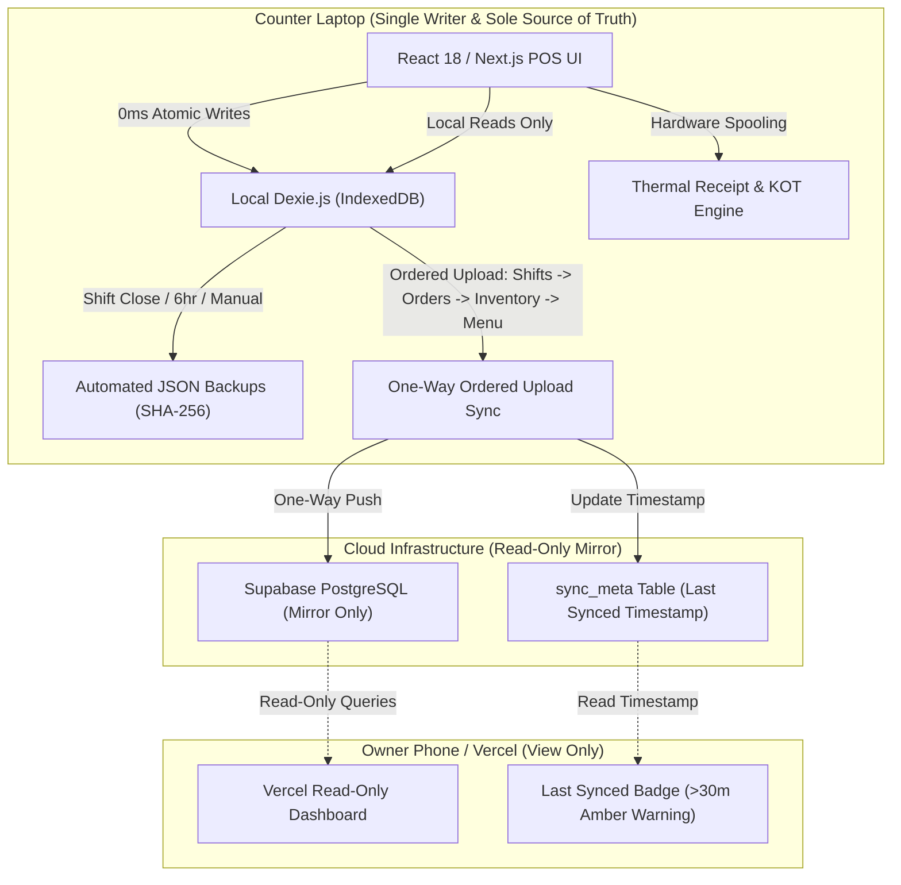
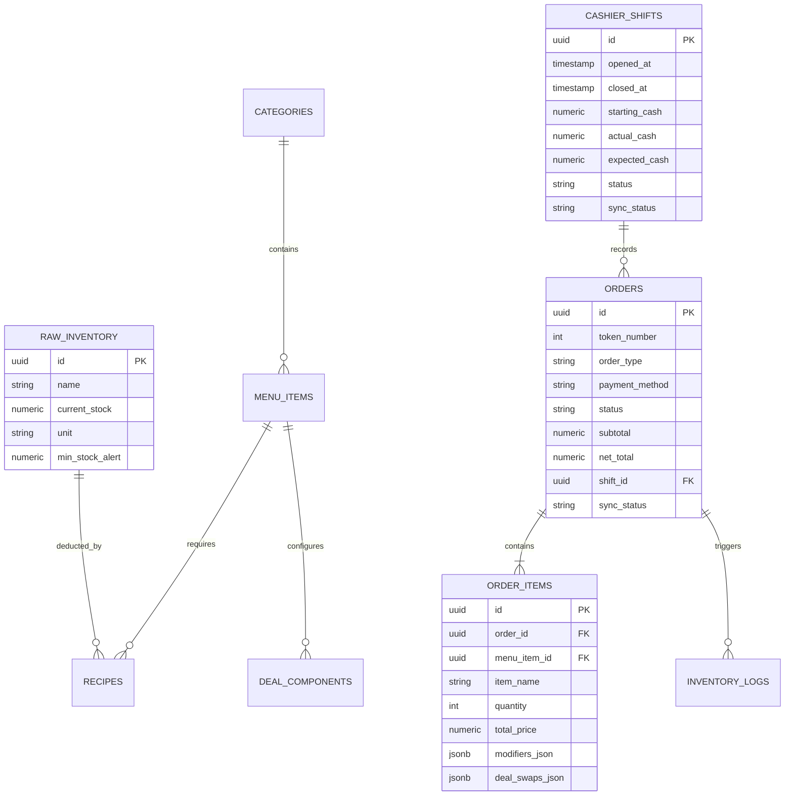

# Muchachos POS — System Architecture & Technical Specifications

> **High-Performance, Local-First Restaurant Point-of-Sale, Real-Time Kitchen Display System (KDS), and Financial Management Engine**  
> *Engineered for zero-latency in-store operations, 100% offline resilience, and seamless cloud synchronization.*

---

## 1. Executive Architecture Summary

Muchachos POS is engineered for 100% offline reliability in a single-restaurant deployment. The system enforces a strict **Single-Writer, One-Way Mirror Architecture**:

1. **The Counter Laptop is the Single Writer & Sole Authority**: The packaged Electron app running an embedded Next.js standalone server with local Dexie.js (IndexedDB) is the ONLY source of truth. All menu, price, recipe, stock, expense, shift, and order mutations execute locally in Dexie.
2. **Laptop Reads Only Local Dexie**: POS, KDS, Admin, and Reports screens on the laptop read exclusively from Dexie. There are zero downstream pulls from Supabase that overwrite local data.
3. **Supabase is a One-Way Read-Only Cloud Mirror**: The laptop uploads changes asynchronously to Supabase when connected. Supabase never pushes changes down to overwrite laptop state.
4. **Phone / Web on Vercel is View-Only**: Mobile access via Vercel provides a read-only reporting view for the owner. All checkout, edit, add, and delete capabilities are locked on the phone.



---

## 2. Core Architectural Pillars

### 2.1. True 0ms Local-First Paradigm
* **Zero Network Latency in Click Paths**: Order creation, item customizations, order voids, mark-ready, shift open/close, and inventory deductions write directly to local IndexedDB inside atomic Dexie transactions. No network call (`await`) sits in any click path.
* **Fail-Safe Offline Mode**: Cashiers can start shifts, record orders, customize deals, print kitchen tokens (KOTs), collect cash/card payments, and finalize shifts without an active internet connection.
* **Explicit, Ordered Upstream Sync**: When connectivity is available, the sync engine executes an ordered pipeline (`shifts` [closed first] -> `orders` -> `order_items` -> `expenses` -> `inventory_logs/snapshot` -> `menu` -> `sync_meta`). Rows are marked `SYNCED` only after the cloud mirror confirms receipt.

### 2.2. Dual-Platform Runtime: Web & Electron Desktop
* **Web Application (Vercel)**: Next.js 14 App Router deployed for the owner's mobile view. Strictly read-only; mutation buttons and checkout are disabled. Authentication required.
* **Desktop Application (Electron)**: Wraps the local standalone server (`http://127.0.0.1:31415`) with native hardware bindings:
  - Bundled embedded Next.js standalone server with zero-internet cold boot.
  - Native folder picker for owner-chosen backup directory.
  - Native thermal printer spooling and cash drawer kick.
  - Hardware keyboard shortcut integration (`F2` for cashier audit, `Alt+T` for dark mode).
  - Single-instance lock and production DevTools disabled.
  - Windows DPAPI credential protection via `safeStorage` and Web Crypto PBKDF2 Master PIN authentication.

---

## 3. Database & Data Model Architecture

The data architecture maintains an identical relational model across local IndexedDB and cloud PostgreSQL.



### 3.1. Local Dexie Database Schema (`MuchachosPosDB`)
IndexedDB stores 10 dedicated object stores with versioned migration schemas:
1. `orders`: Cached orders with local token numbering and sync status tracking.
2. `shifts`: Local register sessions tracking start cash, blind count, and closure notes.
3. `menu_items`: Food catalog with pricing, category associations, and deal flags.
4. `categories`: Food categorization and sorting order.
5. `raw_inventory`: Raw stock counts (e.g. burger patties, buns, cheese, sauce).
6. `recipes`: Bill of materials defining ingredient quantities deducted per menu item.
7. `deal_components`: Flexible deal combos and constituent swap rules.
8. `modifiers`: Add-ons and toppings with custom pricing and ingredient linkages.
9. `inventory_logs`: Cryptographically auditable ledger of stock deductions and restocks.
10. `cashiers`: Cashier profiles with hashed security PINs.

---

## 4. Synchronization & Offline Resilience Engine

### 4.1. Web Locks Cross-Tab Mutex
To prevent race conditions when multiple browser windows or electron instances operate concurrently on the same machine, upstream synchronization leverages the **Web Locks API** (`navigator.locks.request`):
```typescript
await navigator.locks.request('muchachos_sync_orders_lock', { ifAvailable: true }, async (lock) => {
  if (!lock) return; // Another tab is currently syncing; avoid duplicate requests
  await processSyncPendingOrders();
});
```

### 4.2. Upstream Sync Sequencing (Foreign Key Safety)
1. **Shifts Upload First**: `syncOfflineShifts()` upserts local register shifts to `cashier_shifts` to guarantee foreign keys exist in PostgreSQL before order records are processed.
2. **Strict Foreign Key Integrity**: Orders strictly preserve their real `shift_id`. The system never nulls `shift_id` on failure; if a shift fails to upload, its dependent orders are held in the pending queue with the exact error displayed in Sync Diagnostics.
3. **Atomic Upsert & Status Transition**: Orders and line items are batch upserted (`onConflict: 'id'`), followed by marking local records as `'SYNCED'` only after cloud confirmation.
4. **Ledger Snapshot Upload**: Inventory logs and raw stock snapshots are uploaded to mirror cloud counters without executing cloud database triggers.

### 4.3. Disabled Downstream Catalog Overwrites
* Downstream catalog pulling that overwrites local Dexie data is permanently disabled.
* The laptop is the single writer. Catalog edits (menu, categories, recipes, prices) occur on the laptop and upload upstream to Supabase.
* Cloud data never overwrites local laptop Dexie records.

---

## 5. Restaurant Operations & Business Logic

### 5.1. Real-Time Kitchen Display System (KDS)
* **Hybrid Bus Architecture**:
  - **BroadcastChannel API**: 0ms local bus for tabs and popup windows on the same physical POS terminal.
  - **Supabase Realtime WebSockets**: Synchronizes kitchen tickets across separate tablets and monitors in the kitchen.
* **Order Stages**: `PENDING` -> `PREPPING` -> `COMPLETED` -> `CLOSED`.
* **Sound & Visual Alerts**: Real-time auditory chime alerts and color-coded timers indicate wait times.

### 5.2. Automated Recipe & Inventory Deductions
* **Item Deduction**: Selling a burger instantly queries `recipes` to deduct specific amounts of beef, buns, and sauces from `raw_inventory`.
* **Deal Combinations**: Deals support constituent swaps (e.g., swapping Fries for Onion Rings). Inventory accurately traces the swapped items and their individual modifiers.
* **Void Restocking**: Cancelling an order restores the exact deducted ingredients back to the inventory ledger with a logged audit reason (`ORDER_RESTOCK`).

### 5.3. Register Blind Count & Z-Report Reconciliation
* **Preventing Cash Drawer Skimming**: When closing a shift, cashiers are blind to expected totals. They must count physical bills using the denomination calculator (Rs. 5,000 to Rs. 10 notes).
* **Mathematical Variance Audit**: The system reconciles:
  $$\text{Expected Cash} = \text{Starting Cash} + \text{Cash Sales} - \text{Drawer Expenses}$$
  $$\text{Variance} = \text{Actual Cash Counted} - \text{Expected Cash}$$
* Categorizes variances as **Balanced**, **Over (+)**, or **Shortage (-)** and records it to the permanent audit log.

### 5.4. Thermal Printing & Hardware Interface
* **Customer Receipts**: Formatted with store branding, cashier details, tax breakdown, and footer notes.
* **Kitchen Order Tokens (KOT)**: Large token numbers, order channel tags (Dine-In, Takeaway, Foodpanda), table indicators, and modifier tags.
* **Add-on Differentiators**: If a seated table orders extra items, the KOT prints only the newly added items marked as `*** ADD-ON TO KITCHEN ***`.

---

## 6. Financial Analytics & Payment Tracking

The system provides split accounting across sales channels and payment methods:
* **Payment Methods**: `CASH`, `JAZZCASH`, `EASYPAISA`, `CARD`, `FOODPANDA_RECEIVABLE`.
* **Channel Segregation**:
  - **Dine-In**: Tracks table numbers, open tabs, seated guests, and multiple rounds of KOTs.
  - **Takeaway**: Fast-casual instant settlement.
  - **Foodpanda**: Tracks 30% aggregator commission, gross revenue, net payout receivables, and payout batch settlement reconciliation.

---

## 7. Technology Stack Reference

| Layer | Technologies |
|---|---|
| **Frontend Framework** | Next.js 14 (App Router), React 18, TypeScript |
| **State Management** | Zustand (in-memory cart & sessions), Dexie.js (persistent IndexedDB) |
| **Styling & UI** | Tailwind CSS, Lucide React, Shadcn/Radix UI |
| **Backend & Cloud DB** | Supabase (PostgreSQL 15), Supabase Auth, Row-Level Security (RLS) |
| **Realtime Pub/Sub** | Supabase Realtime (WebSockets), Web BroadcastChannel API |
| **Desktop Wrapper** | Electron 44, Electron Builder |
| **Hardware & Printing** | Raw Thermal ESC/POS formatting, Web Print APIs |
| **Deployment & Hosting** | Vercel (Production Web App), GitHub Actions CI/CD |

---

## 8. Development & Production Runbook

### Running Web Development Server
```bash
npm install
npm run dev
# POS accessible at http://localhost:3000/pos
# Admin dashboard at http://localhost:3000/admin
# KDS display at http://localhost:3000/kds
```

### Packaging Windows Electron App
```bash
# Builds the production Next.js application
npm run build

# Packages the Electron application installer (.exe) into dist-electron/
# Utilizes pre-built public/icons/icon.ico and 4GB V8 heap
cmd.exe /c "set NODE_OPTIONS=--max-old-space-size=4096 && npm run electron:dist"
```

### Verifying System Health
```bash
# Type check the entire codebase
npx tsc --noEmit

# Production build test
npm run build
```

---

## 9. Low-Resolution 1366x768 & 720p Laptop Engine

The POS interface implements adaptive layout scaling to ensure standard budget counter laptops (1366x768 screen resolution, often operating at 125% Windows DPI scaling) operate without clipping or hidden elements:

1. **Header Footprint**: Total width constrained to $\le 820\text{px}$. Buttons use `px-2.5 py-1 text-[11px]` and concise labels (`WASTE`, `SHIFT`, `QUEUE`, `KDS`), preventing Cashier badge and Theme toggle clipping.
2. **Vertical Real Estate**: Search bar padding (`px-3 py-1.5`), category pills (`px-3 py-1 text-xs`), menu cards (`min-h-[82px] p-2.5`), and cart checkout elements are compressed to ensure 3 to 4 complete product rows fit on screen.
3. **Electron Window Bounds**: Default window dimensions set to `1280x720` (minimum `960x540`) in `electron/main.js` to clear Windows taskbars.

---

## 10. Multi-Window KDS & Edge Routing Isolation

1. **Independent KDS Window**: The header KDS button opens a secondary window via `window.open('/kds', 'MuchachosKDS', 'width=1280,height=800')` that can be dragged to a secondary kitchen monitor or smart TV.
2. **Global Electron Session User-Agent**: Configured via `session.defaultSession.setUserAgent()` and `app.userAgentFallback` in `electron/main.js` so all popups and child windows inherit the `MuchachosPOS-Desktop` token.
3. **Edge Middleware Routing Exemption**: `src/middleware.ts` detects Electron via `userAgent.toLowerCase().includes('electron')` and explicitly exempts `/kds` from `NEXT_PUBLIC_ADMIN_ONLY` redirects, preventing kitchen screens from bouncing to the Admin login page.

---

## 11. Permanent Thermal Receipt Advertising Engine (Teddops)

All physical and preview customer receipts (Dine-In, Takeaway, Foodpanda) and Z-Reports include a permanent, tamper-proof engineering credit and advertisement:

```text
------------------------------------------------
              SOFTWARE BY TEDDOPS
   Get POS & Custom Software For Your Business
      +92 329 7267098 • +92 323 5930559
```

- **Tamper-Proof**: Hardcoded below `${settings.receiptFooter}` in `src/lib/receipt-printer.ts` and `src/lib/thermal-reports.ts`.
- **Pre-Built Icon Pipeline**: Multi-resolution `public/icons/icon.ico` is compiled directly into the NSIS installer without memory-intensive runtime image conversions.

---

## 12. Engineering Credits & Support

- **Developed By**: **TEDDOPS (PVT) LTD**
- **Lead Engineers**: Engr. Maryam & Kamran
- **Contact Numbers**: `+92 329 7267098` &bull; `+92 323 5930559`
- **Support Email**: `teddopss@gmail.com`

