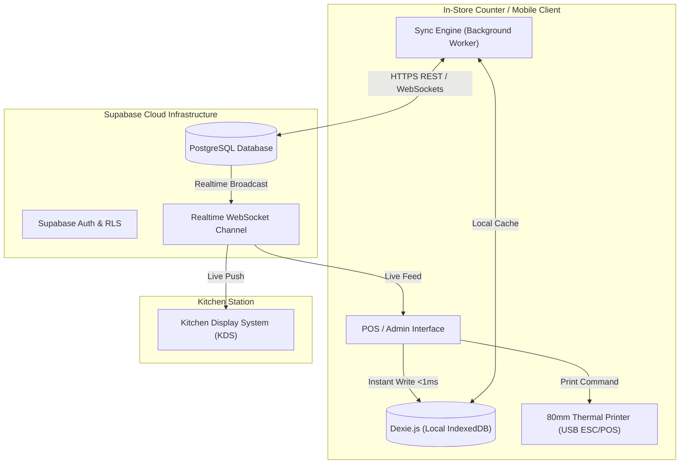

# Muchachos POS - System Architecture & Technical Specification

> **System Version:** 2.0 (Local-First Cloud Synchronized)  
> **Target Hardware:** Desktop POS Terminals, Windows Laptops, Mobile Devices (iOS / Android), Speed-X SP-200U 80mm ESC/POS Thermal Printers.

---

## 1. Executive Summary & Capabilities

Muchachos POS is an enterprise-grade, hybrid local-first restaurant point-of-sale and kitchen management platform designed specifically for fast-paced food businesses. It guarantees **zero counter downtime** during internet outages, provides **microsecond touch responsiveness**, and maintains **real-time synchronization** across all counter terminals, kitchen displays, and mobile devices.

### Core Systems:
1. **Cashier Point of Sale (POS)**: High-speed touch interface for Dine-In, Takeaway, and Foodpanda order dispatching.
2. **Kitchen Display System (KDS)**: Real-time kitchen token queue with live order tickets, modifier tracking, and audio chimes.
3. **Owner & Executive Portal**: Remote mobile-optimized dashboard with live revenue metrics, P&L statements, inventory ledgers, and staff security controls.
4. **Local-First Sync Engine**: Embedded transactional IndexedDB engine (`Dexie.js`) that operates completely offline and syncs upstream/downstream with zero duplicated records.
5. **Hardware Integration**: Native support for 80mm ESC/POS thermal receipt printers (Speed-X SP-200U auto-cutter) and RJ11 cash drawer kick pulses.

---

## 2. Technology Stack

| Layer | Technologies | Purpose |
|---|---|---|
| **Frontend Framework** | **Next.js 14** (App Router), React 18, TypeScript | High-performance server/client hybrid rendering |
| **Styling & UI** | **Tailwind CSS**, Lucide React, Recharts | Professional dark/light mode responsive layout |
| **Local Database** | **Dexie.js** (IndexedDB v4) | In-browser embedded transactional database for 100% offline uptime |
| **Cloud Database** | **Supabase** (PostgreSQL 15) | Relational cloud database, ACID compliance, RPC triggers |
| **Realtime Engine** | **Supabase Realtime WebSockets** | Sub-second order dispatch to KDS and Owner Portal |
| **Desktop Shell** | **Electron 44** | Native Windows wrapper with raw silent printing & cash drawer pulse |
| **Hosting & CDN** | **Vercel Edge Network** | Instant global deployments, sub-50ms TTFB |
| **Receipt Output** | **80mm Thermal HTML-to-Print** | 203 DPI thermal printing formatting calibrated for Speed-X SP-200U |

---

## 3. High-Level Architecture & Data Flow



---

## 4. Local-First & Offline Synchronization Architecture

### The Problem Solved
Traditional cloud POS systems freeze or fail when internet cables are cut or mobile data disconnects. Muchachos POS separates user interaction from network connectivity.

### The Mechanism
1. **Local Reads & Writes**:
   - Every product lookup, table status check, and order placement writes immediately to `Dexie.js` in `<1ms`.
   - Inventory deductions (`current_stock`) are calculated locally in real time so cashiers never sell out-of-stock items while offline.
2. **Offline Order Queue**:
   - When offline, orders receive a permanent cryptographic `UUID` and are tagged with `sync_status = 'PENDING'`.
3. **Automatic Upstream Sync**:
   - A background sync tracker silently pings connectivity every 20 seconds.
   - Upon reconnection, pending orders and cash float records are pushed upstream to Supabase via idempotent `UPSERT` operations.
   - **Zero Duplication**: Because records use exact UUIDs, re-transmissions never create duplicate orders or double-deduct inventory.
4. **Authoritative Downstream Reconciliation**:
   - After upstream push completes, the sync engine pulls the latest cloud menu pricing, deals, and audit ledgers.
   - Cloud PostgreSQL triggers calculate final authoritative stock counts and reconcile them back into Dexie.js.

---

## 5. Pricing & COGS Financial Model (Retail vs Prepared Items)

Muchachos POS implements an automated Cost of Goods Sold (COGS) and profit margin tracking architecture:

1. **Prepared Items (Burgers, Shawarmas, Meals)**:
   - Linked to ingredient recipes (`deductions` JSON).
   - Ingredients are deducted automatically from theoretical and physical stock batches.
2. **Retail Goods (Cold Drinks, Bottled Juices, Pre-packaged Items)**:
   - Items possess an editable `cost_price` and `sell_price`.
   - Deals and combos automatically calculate COGS on the fly (`Item Revenue - Item Cost = Net Margin`).
3. **Foodpanda Accrual Engine**:
   - Foodpanda commissions (e.g., 30%) are tracked separately from gross drawer revenue.
   - Reports provide two distinct views: **Actual Cash in Drawer** vs **Accrual Net Revenue**.

---

## 6. Thermal Receipt Printer Architecture (Speed-X SP-200U)

- **Calibrated Width**: 80mm continuous thermal roll (72mm printable width, 48 columns font A, 203 DPI).
- **Print Modes**:
  - **Browser Mode**: Direct print styled via strict `@media print` CSS rules, disabling browser headers, footers, and margins.
  - **Electron Silent Mode**: Native background print job without dialog popups, routing directly to the default receipt printer.
- **Auto-Cutter Support**: Thermal receipt formats append cut spacing to trigger the printer's mechanical auto-cutter blade.
- **Reports Supported**:
  1. Customer Bill Slip (Token #, Items, Modifiers, GST Tax, Footer Note).
  2. Kitchen Order Ticket (KOT) for chef stations.
  3. Daily Closing Report (Z-Report): Shift reconciliation, payment channel breakdown, drawer variance.
  4. Monthly Financial P&L Statement: Gross sales, COGS, category expenses, net profit margin.

---

## 7. Security & Session Lockdown Architecture

1. **Dual-Layer Access Control**:
   - **Owner Portal**: Protected by email/password Supabase Auth and route-level middleware.
   - **Cashier Terminal**: Protected by 4-digit Cashier PIN credentials stored with encryption.
2. **Immediate Lockout on PIN Change**:
   - When the Owner updates a cashier's PIN from their mobile phone, the change syncs to Supabase.
   - The cashier terminal's active session is invalidated immediately via Realtime broadcast, forcing the cashier to re-enter their new PIN without needing a manual laptop reboot.
3. **Audit Ledger**:
   - Sensitive actions (Voids, Manual stock adjustments, Drawer opens, Discount overrides) create an immutable log in `audit_logs` with timestamps and manager PIN authorization markers.

---

## 8. Low-Resolution Display & Responsive Scaling Engine (1366x768 & 720p)

The POS UI is engineered with adaptive vertical and horizontal compression for budget counter laptops (typically 1366x768 resolution with Windows 125% DPI display scaling):

1. **Header Footprint**:
   - Total horizontal width constrained to $\le 820\text{px}$, preventing Cashier badge, Shift status, and Theme toggle from overflowing or clipping off-screen.
   - Action pills utilize condensed padding (`px-2.5 py-1 text-[11px]`) and streamlined labels (`WASTE`, `SHIFT`, `QUEUE`, `KDS`).
2. **Vertical Screen Space Recovery**:
   - Search bar container reduced to `px-3 py-1.5`.
   - Category filter pills row height compressed to `px-3 py-1` with `text-xs` typography.
   - Menu product cards scaled to `min-h-[82px] sm:min-h-[92px]` with `p-2.5 sm:p-3` padding, ensuring 3 to 4 full product rows are visible without vertical scrolling.
   - Cart panel summary rows, empty states, and payment buttons compacted (`py-2.5 sm:py-3`), recovering over 80px of vertical real estate.
3. **Electron Window Default Bounds**:
   - Main window initialization calibrated to `width: 1280, height: 720` with minimum bounds `960x540` in `electron/main.js`. This guarantees that the Windows taskbar and titlebar never force content off-screen.

---

## 9. Universal Desktop Window Management & KDS Popout Architecture

To support dual-screen restaurant setups (Counter Terminal + Kitchen TV / Display):

1. **Multi-Window Popout**:
   - Tapping the **KDS** button triggers `window.open('/kds', 'MuchachosKDS', 'width=1280,height=800')`.
   - Cashiers can drag this independent window to a second HDMI monitor or smart TV facing the kitchen.
2. **Universal Desktop Session Stamping**:
   - Electron's `session.defaultSession.setUserAgent()` and `app.userAgentFallback` inject `MuchachosPOS-Desktop` across all primary windows, popups, and child processes.
3. **Edge Middleware Exemption**:
   - Next.js Edge Middleware (`src/middleware.ts`) explicitly recognizes all Electron window instances (`userAgent.toLowerCase().includes('electron')`).
   - Route `/kds` is strictly exempt from `NEXT_PUBLIC_ADMIN_ONLY` redirects, guaranteeing that kitchen screens and popup tabs never accidentally redirect to the Owner Admin portal or login page.

---

## 10. Permanent Thermal Receipt Advertising & Engineering Branding (Teddops)

Every printed receipt and report features a tamper-proof engineering credit and advertisement at the bottom:

1. **Tamper-Proof Placement**:
   - Appended directly into the thermal HTML generation stream in `src/lib/receipt-printer.ts` and `src/lib/thermal-reports.ts`.
   - Stays permanently locked below store custom footer messages (`settings.receiptFooter`), preventing accidental erasure via the Admin UI.
2. **Advertisement Format**:
   ```text
   ------------------------------------------------
                 SOFTWARE BY TEDDOPS
      Get POS & Custom Software For Your Business
         +92 329 7267098 • +92 323 5930559
   ```
3. **Cross-Platform Verification**:
   - Reflected identically in on-screen thermal modal previews (`ThermalReceiptPreviewModal.tsx`), settings previews (`ReceiptSettingsModal.tsx`), and physical Speed-X SP-200U 80mm prints.

---

## 11. Standalone Desktop Architecture & Zero-Loss Origin Cutover

### Standalone Embedded Server Architecture (Port 31415)
1. **Cold-Boot Zero-Internet Independence**:
   - The desktop terminal runs 100% offline via Next.js standalone server bundled directly inside the Electron package in `resources/app-server`.
   - Electron spawns the server using `utilityProcess.fork()` (leveraging Electron's embedded Node.js runtime—no system Node.js installation required).
   - Server binds strictly to private loopback interface `127.0.0.1:31415`.
2. **Deterministic Origin & Port Collision Protection**:
   - Because browser storage (`Dexie.js` / IndexedDB and `localStorage`) is strictly partitioned by origin (`http://127.0.0.1:31415`), the port MUST never dynamically change.
   - On boot, Electron checks `http://127.0.0.1:31415/api/health` against `buildToken: "MUCHACHOS_POS_LOCAL_SERVER_V1"`.
   - If port 31415 is occupied by an unrecognized process, Electron displays a fatal error dialog (`dialog.showErrorBox`) and exits cleanly instead of switching ports, preventing silent database partitioning.
3. **Loopback-Only Security Guard (No User-Agent Spoofing)**:
   - Next.js Middleware (`src/middleware.ts`) inspects `request.nextUrl.hostname`.
   - Counter terminal loopback (`127.0.0.1` / `localhost`) is granted direct access to `/admin` and `/pos` behind the local Master PIN modal.
   - Remote deployments (e.g., `https://muchachos-f-8.vercel.app`) strictly require a valid Supabase Auth session (`user !== null`). User-Agent header checks are completely eliminated on cloud deployments, preventing spoofing attacks.

### Origin Cutover & Migration Procedure
Because IndexedDB and `localStorage` are isolated per origin:
1. **Step 1: Zero-Loss Export on Vercel App**:
   - Open existing POS app on `https://muchachos-f-8.vercel.app/admin`.
   - Click **Settings &rarr; Database & Terminal Cutover &rarr; Export Backup**.
   - Verify that all tables have `pendingTotal === 0` (or export anyway to preserve unsynced records).
   - A single JSON snapshot file (`muchachos_pos_full_backup_*.json`) is generated containing all 11 Dexie tables plus all `localStorage` settings (`muchachos_receipt_settings`, `muchachos_active_cashier`, `muchachos_active_shift_id`, `muchachos_kds_enabled`, `theme`).
2. **Step 2: Launch Local Standalone Terminal**:
   - Start the desktop app (`http://127.0.0.1:31415`).
3. **Step 3: Atomic Restore**:
   - Navigate to **Admin Settings &rarr; Database & Terminal Cutover &rarr; Restore / Cutover**.
   - Upload the snapshot JSON and confirm restore.
   - All tables and settings are restored atomically within a single IndexedDB transaction, and the app reloads with 100% identical data.

### Credential Storage, Hardware Re-provisioning (`safeStorage`), & PBKDF2 Master PIN
- **Master PIN Security (PBKDF2-SHA256)**:
  - Default hardcoded PINs (`7788`) are completely eliminated. On first launch, the store owner is required to configure a private 4-digit Master PIN.
  - Hashing utilizes standard Web Crypto PBKDF2-SHA256 with 100,000 iterations and a cryptographically secure, random per-device 16-byte salt (`crypto.getRandomValues`).
  - **Protected Lockout Counter**: Failed attempts are tracked in the Electron main process (`terminal-lockout.json` in `userData`), rendering the lockout counter immune to cashiers clearing browser cookies, `localStorage`, or IndexedDB. After 5 consecutive invalid entries, the interface locks down for 5 minutes with a live countdown timer.
- **Terminal Identity Provisioning via Windows DPAPI (`safeStorage`)**:
  - The owner provisions terminal sync credentials (`terminal@muchachos.pk`) through the Admin Settings modal.
  - Electron's `safeStorage` API encrypts values using Windows DPAPI and stores them in `userData/terminal-identity.enc`.
  - When background session tokens expire while the laptop is offline, the sync engine retrieves decrypted credentials from the main process to silently re-authenticate without interrupting counter sales.
  - **DPAPI Machine Binding**: Encryption keys are tied directly to the current Windows user account and machine hardware. Reinstalling Windows, resetting the Windows user profile, or migrating to a different PC requires re-provisioning the terminal credentials.

### Automated Packaging & Standalone Node Modules (`afterPack`)
- Build pipeline features an automated `afterPack` hook (`scripts/after-pack.js`) executed during `electron:pack` and `electron:dist`.
- Because `electron-builder` by default excludes subdirectories named `node_modules` in `extraResources`, the `afterPack` hook automatically inspects `dist-electron/win-unpacked/resources/app-server/node_modules` and copies the Next.js standalone runtime modules directly before installer compression.

### Immutable Audit Logs & Storage Metrics
- All sensitive operations (Voids, drawer opens, discount overrides, manual stock edits) write to `audit_logs`.
- PostgreSQL trigger `trg_audit_logs_immutable` rejects all `UPDATE` and `DELETE` queries at the database engine level.
- **Backfill Safety**: Table `orders_pre_backfill_backup` is isolated in a private schema (`private_backup`) with Row Level Security and `REVOKE ALL ON TABLE ... FROM anon, authenticated, public`, ensuring historical order snapshots are invisible to PostgREST and public API endpoints.
- **Storage Metrics**: An active restaurant generating ~150 audit entries per day consumes ~20 KB daily, or ~7.3 MB per year. 5 years of operation requires less than 40 MB of database storage, making indefinite retention completely viable with zero cloud performance impact.

---

## 12. Support & Engineering Contacts

- **Engineering Company**: **TEDDOPS (PVT) LTD**
- **Lead Engineers**: Engr. Maryam & Kamran
- **Direct Contacts**: `+92 329 7267098` &bull; `+92 323 5930559`
- **Official Email**: `teddopss@gmail.com`


