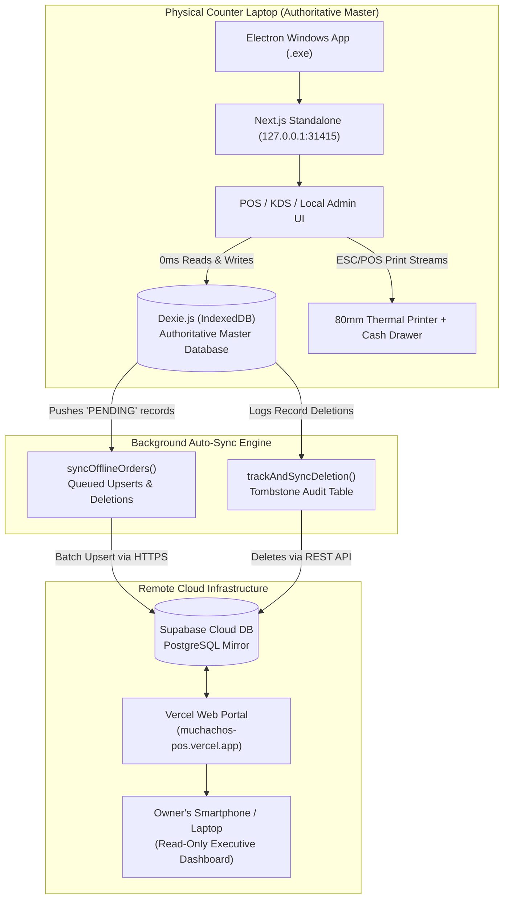

# Technical Stack & System Architecture Summary
**Project:** Muchachos Restaurant Operating System (ROS) / Teddops SaaS POS  
**Architecture:** Offline-First Single Authoritative Writer (Local) + Real-Time Cloud Mirror (Remote)  
**Target Environments:** Windows 10/11 Desktop (.exe) & Cloud Web/Mobile (Vercel)

---

## 1. Executive Summary

This project is an **enterprise-grade, hybrid point-of-sale (POS), kitchen display system (KDS), inventory management, and financial reporting platform** specifically engineered for restaurant operations.

The fundamental design principle is **Zero Operational Downtime**:
* **The Counter Laptop is the Sole Master Writer:** Runs locally as an Electron app using an embedded Next.js standalone server and **Dexie.js (IndexedDB)**. Every cashier transaction, ticket generation, recipe calculation, and inventory deduction happens at **0ms network latency** and works **100% offline**.
* **The Cloud is a Real-Time Read-Only Mirror:** Powered by **Supabase (PostgreSQL)** and hosted on **Vercel**. It allows business owners to view live sales, analytics, inventory levels, and profit & loss (P&L) statements remotely from any smartphone, tablet, or web browser without interfering with counter operations.
* **Asynchronous Auto-Sync:** All local changes are flagged with `sync_status: 'PENDING'` and pushed automatically upstream to Supabase in the background whenever an active internet connection is available.

---

## 2. Comprehensive Tech Stack Breakdown

### 2.1 Frontend & Application Layer
| Layer / Tool | Technology | Version | Purpose |
| :--- | :--- | :--- | :--- |
| **Framework** | Next.js (App Router) | `14.2.35` | Fullstack React framework (Static & Dynamic API routes) |
| **UI Library** | React | `18.3.1` | Core declarative UI rendering |
| **Language** | TypeScript | `^5.x` | End-to-end type safety across DB schemas and POS states |
| **Styling** | Tailwind CSS | `^3.4.1` | Utility-first responsive design, dark/light modes, print CSS |
| **Icons** | Lucide React | `^1.48.0` | Vector UI icons |
| **Charts** | Recharts | `^3.10.1` | Interactive analytics graphs and hourly velocity visualization |
| **Audio** | HTML5 Web Audio API | Native | Kitchen chime notifications on new tickets |

### 2.2 Storage & Database Layer
| Layer | Technology | Role & Behavior |
| :--- | :--- | :--- |
| **Local Client DB** | **Dexie.js (IndexedDB)** `v4.x` | **Authoritative Single Source of Truth**. High-speed transactional storage stored in the laptop's browser profile. Survives restarts and network dropouts. |
| **Reactive DB Hook** | `dexie-react-hooks` (`useLiveQuery`) | Automatically triggers React re-renders whenever IndexedDB tables change (reactive menu prices, live recipe updates, live inventory deductions). |
| **Cloud Mirror DB** | **Supabase (PostgreSQL)** | Remote replica database for mobile dashboard, analytics, and off-site monitoring. |
| **Realtime Engine** | Supabase Realtime (WebSockets) | Streams database updates to remote mobile devices without manual polling. |

### 2.3 State Management & Internal Communication
| Mechanism | Technology | Responsibility |
| :--- | :--- | :--- |
| **Global Client Store** | **Zustand** | Cart state, active shift ID, parked tables, payment selections, modal open/close states. |
| **Event Broadcast Bus** | **HTML5 BroadcastChannel** (`posBus`) | Zero-latency cross-tab and cross-window pub/sub channel (`ORDER_CREATED`, `ORDER_COMPLETED`, `MENU_UPDATED`, `EXPENSE_LOGGED`). Synchronizes POS, KDS, and Admin tabs instantly on the same machine. |
| **Client Cache** | `adminCache` (in-memory Map) | In-memory query caching with instant event-driven invalidation. |

### 2.4 Desktop Packaging & Hardware Integration
| System | Technology | Details |
| :--- | :--- | :--- |
| **Desktop Shell** | **Electron** (`v44.x`) | Wraps the application into a standalone Windows desktop executable (.exe). |
| **Process Model** | Node.js Standalone Runner | Electron's main process runs `server.js` (Next.js standalone build) pinned to `127.0.0.1:31415`. |
| **Single-Instance Guard** | `app.requestSingleInstanceLock()` | Prevents multiple POS instances from opening and locking IndexedDB. |
| **Thermal Printing** | ESC/POS & Raw Window Print | 80mm thermal receipt printing, auto-cutter commands, and cash drawer RJ11 kick pulses. |

### 2.5 Cloud Hosting & DevOps
| Component | Platform / Service | Role |
| :--- | :--- | :--- |
| **Cloud Deployment** | **Vercel** | Hosts the web app for remote access (`/mobile`, `/admin`). |
| **Edge Fallback** | **Cloudflare Pages / Workers** | Compatible edge hosting alternative for unlimited bandwidth. |
| **VCS Repository** | **GitHub** | Version control (`main` branch for production, `teddops-saas` for sandbox). |
| **Keep-Alive Cron** | **GitHub Actions** (curl workflow) | Automated HTTP ping every 3 days to prevent Supabase Free-Tier database auto-pausing. |

---

## 3. System Architecture & Data Flow

---

## 4. Key Subsystems & Core Logic

### 1. POS Order Checkout & Flow Handling
* **Flow 1: Dine-In Tabs:** Tables can be parked and reopened. Orders stay in `OPEN_TAB` state until settled at checkout.
* **Flow 2: Fast-Casual & Foodpanda:** Fast counter takeaway or delivery orders. Saved atomically with status `PENDING`, immediately sending tickets to the Kitchen Display System (KDS).
* **Bill Splitting & Amendments:** Allows amending existing open bills without duplicating inventory deductions.

### 2. Kitchen Display System (KDS)
* Real-time order cards display order type, table number, token number, modifier choices, and timer countdown.
* Web Audio chimes trigger on new orders.
* Cashiers/chefs click **"Mark as Ready"**, which moves the order to `COMPLETED` and notifies the counter.

### 3. Inventory & Recipe BOM (Bill of Materials) Engine
* **Raw Inventory:** Tracks stock levels, units (kg, grams, liters, units), and purchase costs.
* **Recipe Costing:** Every menu item is linked to raw ingredients. 
* **Dynamic Reactive COGS:** When an ingredient is restocked at a new price, the system automatically recalculates the Cost of Goods Sold (COGS) and profit margins for all linked menu items across the entire catalog.
* **Auto-Deductions:** Placing an order automatically deducts the recipe's exact ingredient quantities from raw stock.

### 4. Financial & P&L Reporting
* **Shift Management:** Cashiers enter opening float, log cash drops, and reconcile cash/card/Foodpanda upon closing with auto-generated **Z-Reports**.
* **Foodpanda Reconciliation:** Handles Foodpanda standard 30% platform commission rates, payout tracking (`PENDING_PAYOUT` vs `SETTLED`), and net payout variance.
* **Expense Ledger:** Direct tracking of daily operational expenses with category breakdown and real-time Net Profit adjustment.

### 5. Multi-Device Role & Security Protection
* **`isLaptopWriter()` Barrier:** A hardware/URL origin check ensuring that only the physical counter laptop (`http://127.0.0.1:31415`) has permission to write, modify, or delete database records.
* **Mobile Read-Only Protection:** Remote users on phones can view metrics, sales, and inventory, but all write buttons (Edit Price, Delete Expense, Restock, Settle Bill) are completely stripped from the UI.
* **Master PIN Security:** Sensitive operations (super admin reset, terminal provisioning, shift audit overrides) require an encrypted 4-digit Master PIN.

---

## 5. Summary Table: Why This Tech Stack Was Chosen

| Challenge | Solution Implemented |
| :--- | :--- |
| **Internet Outages** | Local-First Dexie.js database guarantees 100% counter operation even with zero internet. |
| **Slow Checkout Latency** | Direct in-memory / IndexedDB writes result in 0ms counter response time. |
| **Remote Owner Visibility** | Supabase Cloud Mirror + Vercel mobile site allows instant smartphone monitoring from anywhere. |
| **Hardware Portability** | Electron bundle packages standalone Node.js and Chromium into a standard 1-click Windows installer. |
| **Database Cost Control** | Supabase Free-Tier PostgreSQL kept awake via automated, lightweight GitHub Actions keep-alive pulse. |
