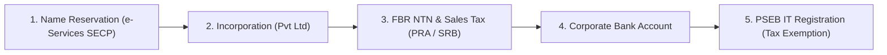

# Muchachos POS — Contract Addendum & Commercial Legal Guide

> **Prepared by:** TEDDOPS (PVT) LTD  
> **Lead Engineers:** Engr. Kamran & Engr. Maryam  
> **Target Audience:** Internal Teddops Leadership & Client Handover  
> **Jurisdiction:** Islamabad Capital Territory / Punjab, Islamic Republic of Pakistan

---

## 1. Commercial Reality & Valuation Context

| Metric | Current Contract Reality | Commercial Market Benchmark |
|---|---|---|
| **Setup Fee** | PKR 25,000 | PKR 150,000 – 400,000 |
| **Monthly Retainer** | PKR 7,000 / month (6 months) | PKR 15,000 – 35,000 / month (SaaS / SLA) |
| **Total Realized** | PKR 67,000 (~$240 USD) | PKR 1.5M – 3.0M (Replacement Dev Cost) |
| **System Delivered** | Enterprise hybrid local-first POS, KDS, automated recipe inventory deduction, blind drop shift tracking, 80mm ESC/POS hardware print engine. |

Because Muchachos received an enterprise-grade custom system at an introductory pilot rate (~4% of full development cost), Teddops must protect its intellectual property, hosting liability, and recurring business model through an enforceable **Contract Addendum**.

---

## 2. Key Contract Gaps & Critical Addendum Clauses

### Gap 1: Cloud Hosting & Third-Party Infrastructure Costs
* **Current Issue**: The PKR 7,000 monthly retainer is approximately equal to or less than the raw operating cost of paid cloud infrastructure (Supabase Pro is ~$25/mo, Vercel commercial tiers, backup storage). If Teddops absorbs hosting, Teddops operates at a financial loss.
* **Addendum Clause**:
  > **Clause 4.1 (Infrastructure & Hosting Ownership):**  
  > *"All third-party cloud hosting accounts (including but not limited to Supabase, Vercel, domain registration, and SMS/WhatsApp notification APIs) shall be registered under the Client’s name and billed directly to the Client's corporate payment method. The monthly software support retainer of PKR 7,000 paid to Teddops covers solely engineering maintenance, bug resolution, and operational assistance, and does not include third-party infrastructure disbursements."*

---

### Gap 2: Tamper-Proof Thermal Receipt Advertising Rights
* **Current Issue**: Customer receipts print the Teddops engineering credits and contact numbers. Without an explicit contractual clause, the client might demand its removal or claim breach of privacy.
* **Addendum Clause**:
  > **Clause 8.3 (Promotional Attribution & White-Label Option):**  
  > *"In consideration of the promotional pilot discount applied to the initial system setup fee, the Client agrees that all printed thermal receipts and reports generated by the Software shall retain the standard Teddops engineering attribution and contact information. Removal or white-labeling of this attribution requires mutual written agreement and payment of a one-time White-Label Buyout Fee of PKR 75,000."*

---

### Gap 3: The 6-Month Renewal Cliff
* **Current Issue**: The initial retainer ends after 6 months. There is no auto-continuation mechanism, which could lead to service abandonment or uncompensated maintenance expectations.
* **Addendum Clause**:
  > **Clause 3.2 (Term & Auto-Renewal):**  
  > *"Upon conclusion of the initial six (6) month pilot term, this Agreement shall automatically renew on a month-to-month basis at the prevailing standard maintenance rate (minimum PKR 10,000 per month), unless either party provides thirty (30) days' written notice of termination. Failure to maintain an active maintenance plan shall result in cessation of cloud synchronization bridges, remote access tunnels, and engineering support, though local counter POS functionality on the licensed terminal shall remain accessible."*

---

### Gap 4: Liability Cap & Operational Disclaimers
* **Current Issue**: Unlimited liability is dangerous for high-volume food businesses where a kitchen delay or hardware power surge could cause lost sales.
* **Addendum Clause**:
  > **Clause 11.1 (Limitation of Liability):**  
  > *"To the maximum extent permitted by applicable law, in no event shall Teddops, its directors, or engineers be liable for any indirect, incidental, special, punitive, or consequential damages (including loss of profits, revenue, or inventory) arising from hardware power surges, thermal printer jams, internet outages, or operational interruptions. Teddops' aggregate cumulative liability under this Agreement shall be strictly capped at the total fees paid by the Client to Teddops during the three (3) months preceding the incident."*

---

### Gap 5: Support SLA & Working Hours
* **Current Issue**: Undefined response expectations can lead to cashiers calling at 2:00 AM for routine paper-jam queries.
* **Addendum Clause**:
  > **Clause 6.2 (Support SLA & Escalation):**  
  > *"Standard technical support is available Monday through Saturday between 11:00 AM and 11:00 PM PKT. Urgent counter-blocking issues (e.g. complete terminal crash during active service) shall receive a first response within sixty (60) minutes. Non-critical feature requests or minor reporting queries shall be queued for standard business hours."*

---

## 3. SECP Registration & Corporate Structuring Roadmap for Teddops

To scale from freelance/contracting to enterprise software vending in Pakistan, Teddops must complete formal incorporation:

### 1. SECP Private Limited Incorporation
* **Portal**: SECP e-Services (`eservices.secp.gov.pk`).
* **Entity Type**: Private Limited Company (`TEDDOPS (PVT) LIMITED`) or Single Member Company (`SMC-PVT LTD`).
* **Requirements**:
  - Minimum 2 Directors (Engr. Kamran & Engr. Maryam).
  - CNIC copies, active mobile numbers, and email addresses.
  - Memorandum of Association (MoA) specifying Software Development, IT Services, and Cloud Consulting.
  - Authorized Capital: Typically PKR 100,000 (minimum statutory stamp duty).
* **Timeline**: 2 to 4 business days upon electronic submission.

### 2. FBR NTN & Provincial Sales Tax Registration
* **Federal (FBR)**: Corporate National Tax Number (NTN) issued via Iris portal.
* **Provincial Sales Tax**:
  - Islamabad: ICT Sales Tax on Services.
  - Punjab: Punjab Revenue Authority (PRA) registration for IT-enabled services.
  - Benefit: Registered IT services in Pakistan enjoy zero or concessionary sales tax rates (typically 0% to 5% under IT policy).

### 3. Corporate Banking & Electronic Payments
* Open a corporate PKR account with a major commercial bank (Meezan Bank, HBL, Bank Alfalah).
* Enables formal invoicing, online client bank transfers, and direct merchant account integration for payment gateway reselling (e.g., PayFast, QisstPay, 1Link).

### 4. PSEB (Pakistan Software Export Board) Registration
* Register Teddops with PSEB as an accredited software development house.
* **Key Benefits**:
  - Income tax exemption on software export remittances until 2026+.
  - Subsidized cloud credits, international trade delegations, and subsidized intern placement programs.
  - Massive credibility boost when pitching large restaurant chains, franchises, and enterprise clients.

---

## 4. Immediate Action Checklist for Handover

1. [ ] Print and sign the **Muchachos POS Handover Protocol & Sign-Off**.
2. [ ] Attach the **Contract Addendum (Cloud Hosting & Maintenance SLA)** to the existing agreement.
3. [ ] Confirm that Muchachos creates their own Supabase project or enters their corporate card for cloud database hosting before Month 7.
4. [ ] Keep all git commits signed and tagged (`v2.0-standalone-desktop`).
