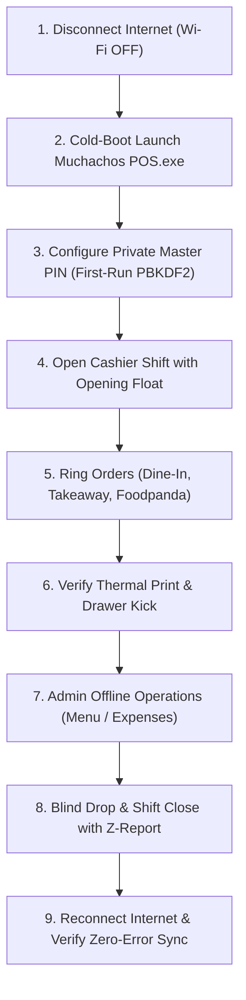

# Muchachos POS — Handover Verification & Offline Simulation Protocol

> **Target Release:** v2.0 Standalone Desktop (Electron 44 + Next.js 14 Standalone + Dexie.js)  
> **Deployment Origin:** `http://127.0.0.1:31415` (Private Loopback)  
> **Target Hardware:** Windows 10/11 Counter Laptop + Speed-X SP-200U 80mm ESC/POS Thermal Printer + RJ11 Cash Drawer

---

## 1. Pre-Deployment Origin Cutover (If Migrating from Cloud Web App)

If the restaurant was previously running the counter via `https://muchachos-f-8.vercel.app`:

1. **Open Existing Web POS**: Navigate to `https://muchachos-f-8.vercel.app/admin`.
2. **Export Full Backup**:
   - Go to **Settings &rarr; Database & Terminal Cutover &rarr; Export Backup**.
   - Confirm all tables show `0 pending` (or export anyway to safeguard pending mutations).
   - Save the generated snapshot JSON file (`muchachos_pos_full_backup_*.json`) to a USB drive or local disk.
3. **Close Web Browser**: Terminate any open browser tabs accessing the cloud URL.

---

## 2. Offline Cold-Boot Shift Simulation Checklist

Perform this exact simulation on the restaurant laptop before handing over the terminal to the cashier.



### Step 1: Disconnect Network (Total Air-Gap)
- [ ] Turn off Windows Wi-Fi completely (or enable Airplane Mode).
- [ ] Disconnect any physical Ethernet cable.
- [ ] Verify Windows shows "No Internet Access".

### Step 2: Cold-Boot Standalone Application
- [ ] Double-click `dist-electron\win-unpacked\Muchachos POS.exe` (or the desktop shortcut created by the installer).
- [ ] Verify the application window opens with dark slate styling (`#0F172A`).
- [ ] Verify that **NO white screen**, **NO connection error**, and **NO redirect to Vercel** occurs.
- [ ] Check internal connection: The embedded Next.js standalone server starts automatically on `127.0.0.1:31415`.

### Step 3: First-Run Master PIN Setup
- [ ] Click the **Admin** shield icon in the top header.
- [ ] The system prompts: **"Set Master PIN — First Run Setup"**.
- [ ] Enter a new 4-digit Master PIN and confirm it.
- [ ] Verify the PIN derivation completes instantly via PBKDF2-SHA256 (100,000 rounds with random 16-byte salt).
- [ ] Close and re-open Admin: Confirm entry requires the newly set PIN.
- [ ] *(Optional Security Check)*: Intentionally type 5 incorrect PINs. Confirm the interface locks down for 5 minutes with a live countdown timer.

### Step 4: Cashier Login & Shift Opening
- [ ] Return to POS (`/pos`).
- [ ] Select Cashier (e.g. `Kamran` or `Staff`) and enter the 4-digit Cashier PIN.
- [ ] Enter the starting cash drawer float (e.g. `Rs. 5,000`).
- [ ] Confirm shift opens and header status updates to **Active Shift**.

### Step 5: High-Speed Counter Order Ring-Up
- [ ] **Order 1 (Dine-In)**:
  - Add 2 Burgers, 1 Fries, 2 Drinks.
  - Select Table `T-01`.
  - Settle with Cash (`Rs. 2,000` received, verify change calculation).
- [ ] **Order 2 (Takeaway)**:
  - Add 1 Large Pizza + Extra Cheese modifier.
  - Settle with Card (`Rs. 1,500`).
- [ ] **Order 3 (Foodpanda)**:
  - Ring 1 Combo Deal.
  - Settle as Online/Foodpanda payment.
- [ ] Verify 0ms UI latency: Items appear instantly with zero loading spinners or network stalls.

### Step 6: Hardware Output Verification (Print & Drawer)
- [ ] **Thermal Print**:
  - Speed-X SP-200U 80mm printer triggers silent auto-print without browser dialog.
  - Inspect physical slip:
    - Customer order details, items, prices, and tax are legible.
    - Custom store footer appears.
    - **Tamper-Proof Teddops Credit**: Check that the bottom lines show:
      ```text
      ------------------------------------------------
                    SOFTWARE BY TEDDOPS
         Get POS & Custom Software For Your Business
            +92 329 7267098 • +92 323 5930559
      ```
- [ ] **Cash Drawer Kick**:
  - Cash payment triggers the RJ11 cash drawer solenoid open pulse (`ESC p 0 25 250`).
  - Cash drawer pops open cleanly.

### Step 7: Popout KDS Screen
- [ ] Click the **KDS** button in the header.
- [ ] Verify the KDS opens in a standalone window (`/kds`).
- [ ] Confirm the newly rung orders appear on the kitchen ticket queue.
- [ ] Tap "Mark Ready" on an order and verify status updates locally.

### Step 8: Offline Admin Operations
- [ ] Open Admin Portal (`/admin`) using the Master PIN.
- [ ] **Expenses**: Record a petty cash expense (e.g. `Milk / Tea: Rs. 350`).
- [ ] **Menu Management**: Update a menu item's price or add a new test drink.
- [ ] Verify that changes save immediately to local Dexie storage without requiring an internet connection.

### Step 9: Blind Drop & Shift Close with Z-Report
- [ ] Return to POS and click **Shift &rarr; End Shift**.
- [ ] Cashier performs **Blind Drop** (enters physical cash counted in drawer without seeing the system target).
- [ ] Click **Finalize Shift**.
- [ ] Verify Z-Report prints on 80mm thermal paper:
  - Opening Cash Float: `Rs. 5,000`
  - Cash Sales: matches cash orders
  - Cash Expenses: `- Rs. 350`
  - Expected Cash in Drawer = `Opening + Cash Sales - Expenses`
  - Discrepancy (Over / Short): calculated accurately
  - Shift summary and audit log recorded in local storage.

### Step 10: Reconnection & Cloud Synchronization
- [ ] Turn Windows Wi-Fi back ON.
- [ ] Watch the POS top bar connectivity indicator transition from **Offline** to **Online**.
- [ ] The background sync engine initiates upstream batch synchronization:
  - Shifts push first (`cashier_shifts`).
  - Orders push second (`orders`), linked to the newly synced shift ID.
  - Order items and inventory deductions follow.
- [ ] Open the Supabase Cloud Dashboard or Owner Phone App:
  - Confirm all offline orders, shifts, and expenses are present in Supabase with exact timestamps.
  - Confirm zero duplicate records.

---

## 3. Emergency Troubleshooting & Support SOP

| Symptom | Diagnostic Step | Immediate Resolution |
|---|---|---|
| Port 31415 Conflict Error Dialog on boot | Run `netstat -ano \| findstr 31415` in PowerShell | Identify PID holding port 31415 and terminate via Task Manager. |
| Master PIN Locked Out | Cashier attempted 5 invalid PINs | Wait 5 minutes for protected lockout timer to expire, or owner unlocks via terminal identity. |
| Printer prints blank or skips cutting | Check USB cable & DIP switches | Ensure Speed-X SP-200U auto-cutter is enabled in printer properties. |
| Missing node_modules error | Build issue | Verified via `scripts/after-pack.js`. Re-run `npm run electron:pack`. |

---

## 4. Handover Sign-Off

- **Teddops Lead Engineer**: Engr. Kamran / Engr. Maryam  
- **Client Representative**: Muchachos Restaurant Management  
- **Handover Date**: October 2026  
- **Emergency Engineering Support**: `+92 329 7267098` • `+92 323 5930559` • `teddopss@gmail.com`
