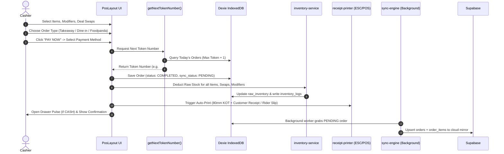
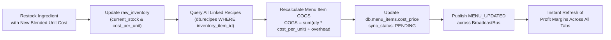
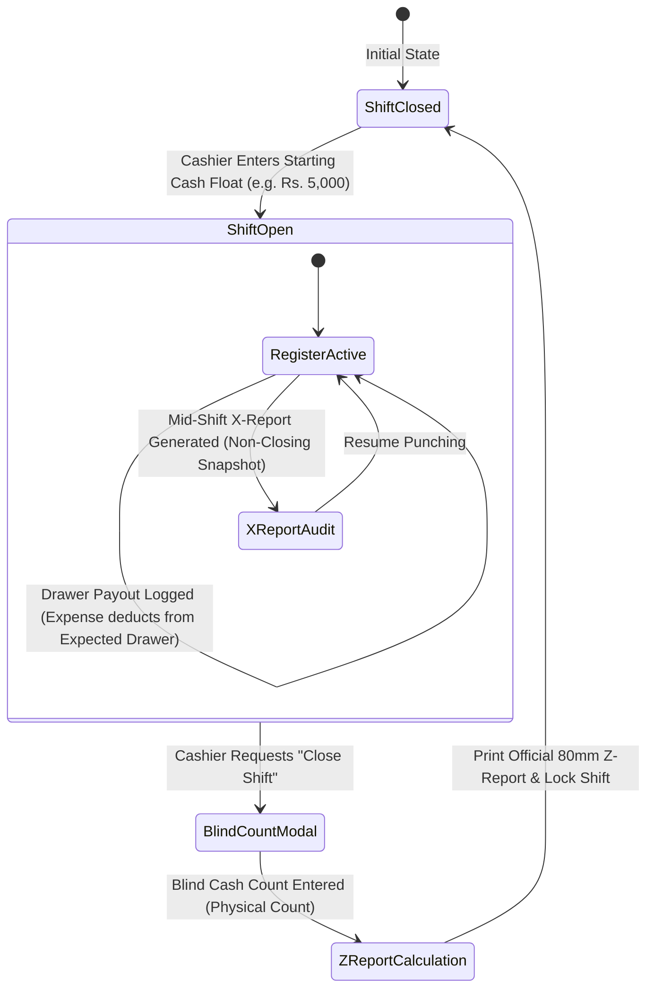
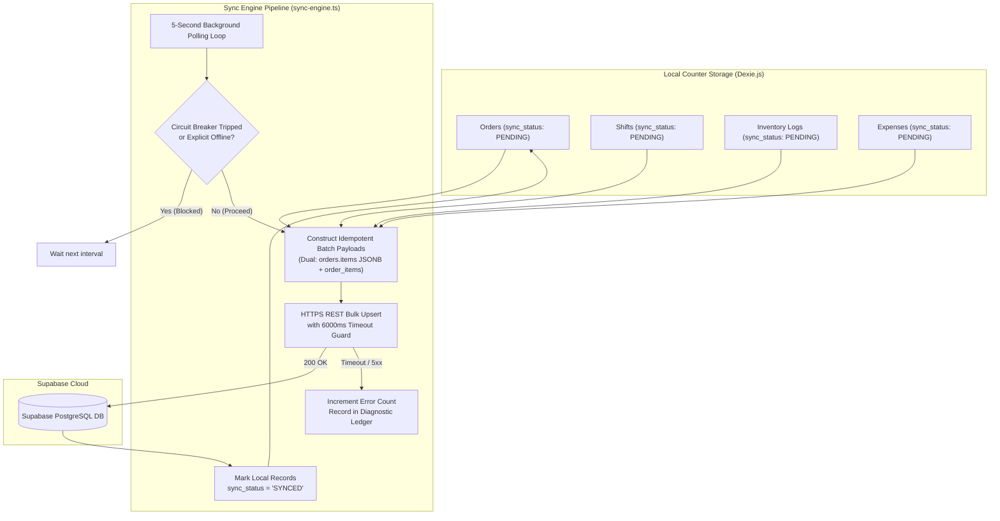
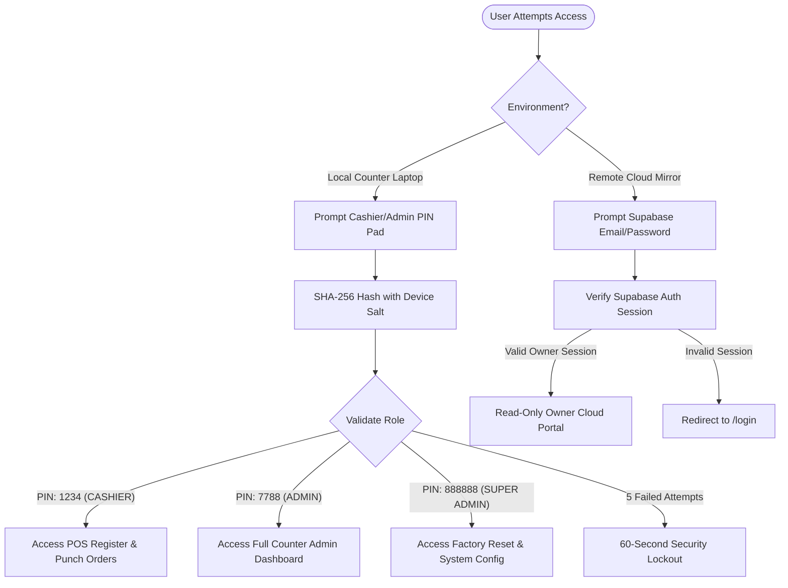

# MUCHACHOS RESTAURANT OPERATING SYSTEM (ROS)
# Master Technical Architecture, System Specifications & Operational Runbook
**Document Identifier:** `projectpos.md`  
**Application ID:** `pk.muchachos.pos`  
**Software Version:** `0.1.0-PRODUCTION`  
**Architecture Topology:** Offline-First Single Authoritative Writer (Local) + Real-Time Read-Only Cloud Mirror (Remote)  
**Authoritative Repositories & Endpoints:**
- **Local Windows Counter Port:** `http://127.0.0.1:31415` (Embedded Standalone Loopback)
- **Production Cloud Mirror:** [https://muchachos-f-8.vercel.app](https://muchachos-f-8.vercel.app)
- **Secondary Production Alias:** [https://muchachos-pos.vercel.app](https://muchachos-pos.vercel.app)
- **Supabase Cloud Project:** `https://qoeapcxyupyugqrmjcnp.supabase.co`
- **Git VCS Repository:** `https://github.com/kamranahmed0611/muchachos-pos.git` (`main` branch)

---

## 1. Executive Summary & System Philosophy

**Muchachos Restaurant Operating System (ROS)** is an enterprise-grade, omnichannel fast-casual point-of-sale, kitchen display, inventory control, and financial reporting platform engineered specifically for Muchachos (F-8 Markaz, Islamabad).

The system resolves the critical vulnerability of cloud-only point-of-sale systems: **network dropouts causing counter operational failure**. It implements a strict **Single Authoritative Writer** topology:

1. **The Physical Counter Laptop is the Sole Master Writer:**
   - Runs a locally packaged Electron container housing a dedicated Node.js Next.js 14 standalone production server and an IndexedDB database powered by Dexie.js.
   - All cashier transactions, token allocations, order ticket creation, and inventory deductions execute at **0ms network latency**.
   - 100% operational offline without internet connectivity. Thermal printers print locally via hardware ports, cash drawers trigger automatically, and shift logs persist safely on the physical machine.
2. **The Cloud Mirror is Strictly Read-Only:**
   - Hosted on Vercel Edge/Serverless infrastructure with Supabase PostgreSQL as the cloud mirror database.
   - Designed for the restaurant owner to monitor live store metrics, review today's gross and net revenue, inspect hourly velocity, monitor raw ingredient depletion, and audit shift performance remotely from any smartphone, tablet, or external computer.
   - Strictly protected by read-only guardrails: POS register access (`/pos`) is blocked, thermal printer configurations are disabled, remote order voiding is disallowed, and database destruction commands are stripped.
3. **Asynchronous Upstream Sync Engine:**
   - When the counter laptop has internet access, an automated background sync engine flushes dirty records (`sync_status: 'PENDING'`) upstream to Supabase via idempotent batch operations.
   - The cloud mirror reads from Supabase via WebSockets (Supabase Realtime) with an automatic 20-second background polling fallback and a zero-delay manual cache-bust button.

---

## 2. System Specifications & Environmental Requirements

### 2.1 Hardware Requirements (Physical Counter Terminal)

| Component | Minimum Specification | Recommended Specification |
| :--- | :--- | :--- |
| **Processor (CPU)** | Intel Core i3 (7th Gen) / AMD Ryzen 3 | Intel Core i5 (10th Gen+) / AMD Ryzen 5 |
| **RAM** | 4 GB DDR4 | 8 GB DDR4 or higher |
| **Storage** | 128 GB SSD (SATA III) | 256 GB NVMe M.2 SSD |
| **Display** | 1366 x 768 Resolution (14") | 1920 x 1080 Full HD Touchscreen Display |
| **Receipt Printer** | 80mm ESC/POS Thermal Printer (USB / Virtual COM) | 80mm Auto-Cutter Thermal Printer (Ethernet / USB) |
| **Cash Drawer** | Standard RJ11 12V/24V Drawer connected to Thermal Printer | Standard Heavy-Duty RJ11 24V Drawer |
| **Kitchen Display (KDS)** | Optional secondary HDMI/VGA monitor or tablet on LAN | Dedicated 1080p Wall-Mounted Display running `/kds` |
| **Operating System** | Windows 10 Home/Pro 64-bit (Build 19041+) | Windows 11 Pro 64-bit |

### 2.2 Software Runtime & Dependencies

| Layer | Technology | Specification / Version |
| :--- | :--- | :--- |
| **Desktop Runtime** | Electron | `44.4.5` (Chromium 122+ runtime) |
| **Server Engine** | Node.js Standalone | `v20.x LTS` or `v24.x` |
| **Web Framework** | Next.js (App Router) | `14.2.35` (React `18.3.1`) |
| **Local Storage** | Dexie.js (IndexedDB wrapper) | `^4.4.6` with `dexie-react-hooks` |
| **Cloud Storage** | Supabase JS Client | `@supabase/supabase-js ^2.117.2` |
| **UI Styling** | Tailwind CSS + Lucide Icons | `tailwindcss ^3.4.1`, `lucide-react ^1.48.0` |
| **Charts & Visuals** | Recharts | `^3.10.1` |
| **State Bus** | HTML5 BroadcastChannel | Channel: `muchachos_realtime_pos_bus` |
| **Packaging Tool** | Electron Builder | `^26.15.3` (Target: Windows NSIS installer) |

### 2.3 Network & Loopback Configuration

- **Local Server Binding:** Strictly pinned to `127.0.0.1:31415`. Pinned loopback ensures IndexedDB security origin isolation (`http://127.0.0.1:31415`) and prevents database detachment.
- **Single Instance Mutex:** Electron enforces `app.requestSingleInstanceLock()`. If a second copy is opened, the running window is focused and the second instance terminates immediately.
- **Port Collision Guard:** Electron validates `http://127.0.0.1:31415/api/health`. If occupied by an alien process, it alerts the operator and prevents data corruption rather than switching ports.
- **Cloud Mirror Connectivity:** Uses HTTPS REST and Secure WebSockets (`wss://qoeapcxyupyugqrmjcnp.supabase.co`) with automatic reconnection and circuit breaker failure handling.

---

## 3. High-Level Architectural Topology

```mermaid
flowchart TB
    subgraph CounterTerminal["PHYSICAL COUNTER LAPTOP (Authoritative Master Writer)"]
        direction TB
        ElectronApp["Electron Shell (v44)<br/>Single Instance Locked"]
        LocalServer["Next.js 14 Standalone Server<br/>Node.js (127.0.0.1:31415)"]
        LocalUI["POS Register & Counter Admin<br/>(/pos, /admin, /kds)"]
        DexieDB[("Local Dexie.js IndexedDB<br/>11 Tables (v8 Schema)<br/>100% Offline Master Truth")]
        ThermalHardware["ESC/POS 80mm Printer<br/>& RJ11 Cash Drawer"]
        LocalBackups[("Automated Local Backups<br/>(6h Interval & Shift Z-Report)")]

        ElectronApp -->|Spawns / Monitors| LocalServer
        ElectronApp -->|Loads Local Web URL| LocalUI
        LocalUI -->|0ms Instant Reads/Writes| DexieDB
        LocalUI -->|Raw Byte Stream / ESC/POS| ThermalHardware
        DexieDB -->|SHA-256 JSON Snapshots| LocalBackups
    end

    subgraph SyncPipeline["UNIDIRECTIONAL ASYNC SYNC ENGINE"]
        direction TB
        SyncWorker["Upstream Queue Worker<br/>(5s Polling Interval)"]
        CircuitBreaker["Circuit Breaker & Retry Buffer<br/>(Backoff & Error Ledger)"]
        
        DexieDB -.->|Polls PENDING Records| SyncWorker
        SyncWorker -->|Failure Detection| CircuitBreaker
    end

    subgraph CloudCloud["SUPABASE CLOUD INFRASTRUCTURE"]
        direction TB
        SupabaseDB[("Supabase PostgreSQL DB<br/>Normalized Tables + JSONB Views")]
        SupabaseAuth["Supabase Cloud Auth<br/>(Owner Portal Credentials)"]
        RealtimeSockets["Supabase Realtime WebSockets<br/>(CDC Replication)"]

        SyncPipeline -->|HTTPS REST Batch Upsert| SupabaseDB
        SupabaseDB -->|Event Stream| RealtimeSockets
    end

    subgraph OwnerRemote["REMOTE OWNER CLOUD MIRROR (Read-Only)"]
        direction TB
        VercelEdge["Vercel Edge Platform<br/>https://muchachos-f-8.vercel.app"]
        OwnerMobile["Owner Smartphone / Remote PC<br/>Responsive Laptop Admin Clone"]
        ReadSafeguards["Strict Read-Only Guardrails<br/>(/pos Blocked, Destructive Actions Stripped)"]

        VercelEdge -->|Serves Web Application| OwnerMobile
        OwnerMobile -->|Verifies Owner Session| SupabaseAuth
        RealtimeSockets -.->|Push Notifications| OwnerMobile
        SupabaseDB -->|REST Query (20s Polling / Manual)| OwnerMobile
        OwnerMobile --- ReadSafeguards
    end
```

---

## 4. Multi-Device Modes & Role Separation Matrix

The platform dynamically inspects its environment at runtime via `src/lib/device-mode.ts`:

```typescript
export function isLaptopWriter(): boolean {
  if (typeof window === 'undefined') return false;
  if (Boolean((window as any).electronAPI)) return true;
  const host = window.location.hostname;
  return host === '127.0.0.1' || host === 'localhost' || host === '::1';
}
```

### 4.1 Feature & Permission Matrix

| Capability / Action | Counter Laptop (Desktop Master) | Cloud Mirror (Owner Web App) | Implementation Rationale |
| :--- | :---: | :---: | :--- |
| **POS Register (`/pos`)** | **YES** (Full Operational Punching) | **BLOCKED** (Redirects to `/admin`) | Cash register belongs physically at the store counter. |
| **Root Route (`/`)** | Loads POS Register (`PosLayout`) | Auto-redirects to `/admin` | Remote owner always wants dashboard insights immediately. |
| **Order Creation** | **YES** (Writes to Dexie DB) | **READ-ONLY** | Prevents ghost orders from remote browsers. |
| **Order Voiding / Cancelling** | **YES** (Requires Manager PIN) | **DISABLED** (Button Hidden) | Voiding requires visual item inspection at counter. |
| **KOT / Receipt Printing** | **YES** (Direct Thermal Hardware) | **DISABLED** | Printers are hardware peripherals at the restaurant. |
| **Cash Drawer Kick Pulse** | **YES** (RJ11 via ESC/POS) | **DISABLED** | Physical cash security guardrail. |
| **Kitchen Display (`/kds`)** | **YES** (Real-time LAN Display) | **VIEW-ONLY** | Cook kitchen screens run in the branch. |
| **Shift Management (X/Z Reports)** | **YES** (Blind Count & Drawer Cash) | **READ-ONLY** | Shift cash must be counted physically in the drawer. |
| **Ingredient Restock / Editing** | **YES** (Updates BOM & Recalculates) | **READ-ONLY** (Badge shown) | Deliveries are received and weighed physically at store. |
| **Menu Price & Recipe Changes** | **YES** (Updates Dexie & Queues Sync)| **READ-ONLY** (Badge shown) | Prevents conflicting remote recipe updates. |
| **Expense Ledger Entry** | **YES** (Can link to active drawer)| **READ-ONLY** | Counter petty cash is deducted directly from drawer float. |
| **Hardware & KDS Settings** | **YES** (Configures COM ports & IPs)| **HIDDEN** | Hardware configuration is counter-specific. |
| **Factory Reset / Launch Wipe** | **YES** (Guarded by Super Admin PIN)| **STRIPPED** | Eliminates risk of remote catastrophic store data loss. |
| **Cloud Storage 90d Purge** | **NO** (Not applicable locally) | **YES** (Owner Cloud Modal) | Allows owner to purge older cloud logs to stay in free tier. |
| **Counter Live Heartbeat** | N/A (Local terminal) | **YES** (Displays terminal status)| Alerts owner if laptop has been offline > 30 minutes. |

---

## 5. Comprehensive Data Models & Database Schemas

The architecture utilizes a dual-storage pattern: local Dexie.js (IndexedDB) for zero-latency operations and normalized Supabase PostgreSQL for cloud monitoring.

### 5.1 Dexie.js Local Schema (`PosDatabase` - Database: `MuchachosPosDB`)

Dexie schema versions evolved from v1 to v8 to support migrations smoothly without wiping client data. The current active schema is **Version 8**:

```typescript
this.version(8).stores({
  orders: 'id, token_number, status, created_at, order_type, payment_method, sync_status, shift_id',
  raw_inventory: 'id, name, current_stock, unit, sync_status',
  recipes: 'id, menu_item_id, inventory_item_id, sync_status',
  deal_components: 'id, deal_id, menu_item_id, category_id',
  modifiers: 'id, name, inventory_item_id',
  inventory_logs: 'id, order_id, inventory_item_id, sync_status, created_at',
  menu_items: 'id, category_id, category_name, name, is_deal, cost_price, sync_status',
  categories: 'id, name, sort_order, sync_status',
  cashiers: 'id, name, role',
  shifts: 'id, status, opened_at, sync_status',
  expenses: 'id, category, amount, created_at, sync_status'
});
```

#### Detailed Table Specifications (Dexie.js)

1. **`orders` (Table: `LocalOrder`)**
   - `id`: string (UUID v4 primary key)
   - `token_number`: number (Daily sequential 1..N token)
   - `shift_id`: string (Foreign key to active `shifts.id`)
   - `order_type`: `'TAKEAWAY' | 'DINE_IN' | 'FOODPANDA'`
   - `payment_method`: `'CASH' | 'JAZZCASH' | 'EASYPAISA' | 'FOODPANDA_RECEIVABLE' | 'PENDING'`
   - `table_number`: string (Optional table identifier for dine-in)
   - `status`: `'PENDING' | 'COMPLETED' | 'CANCELLED' | 'OPEN_TAB'`
   - `subtotal`: number (Sum of item retail prices before discounts)
   - `discount`: number (Manual or promotional discount in Rs.)
   - `net_total`: number (`subtotal - discount`)
   - `foodpanda_commission_pct`: number (Commission percentage, e.g. 25-30%)
   - `fp_payout_status`: `'PENDING_PAYOUT' | 'RECEIVED' | 'SETTLED' | 'VOIDED' | 'NOT_APPLICABLE'`
   - `created_at`: string (ISO 8601 timestamp)
   - `items`: `OrderItem[]` (JSON line item array containing modifier & recipe snapshots)
   - `sync_status`: `'PENDING' | 'SYNCED'`
2. **`raw_inventory` (Table: `LocalRawInventory`)**
   - `id`: string (UUID)
   - `name`: string (e.g., "Beef Patty 100g", "Burger Bun Brioche", "Cooking Oil")
   - `current_stock`: number (Quantity currently in store in base units)
   - `unit`: string (Base measurement unit: `g`, `ml`, `pcs`, `kg`, `liters`)
   - `cost_per_unit`: number (Blended cost per single base unit in Rs.)
   - `min_stock_alert`: number (Threshold triggering warning badges)
   - `bulk_unit`: string (Optional receiving unit, e.g. "Box", "Crate", "Bag")
   - `conversion_rate`: number (Multiplier: base units per bulk unit, e.g. 50 pcs per box)
   - `bulk_cost`: number (Cost per bulk packaging unit)
   - `is_overhead`: boolean (Flag indicating fixed packaging or operational item)
   - `sync_status`: `'PENDING' | 'SYNCED'`
3. **`recipes` (Table: `LocalRecipe`)**
   - `id`: string (UUID)
   - `menu_item_id`: string (Links to `menu_items.id`)
   - `inventory_item_id`: string (Links to `raw_inventory.id`)
   - `quantity_deducted`: number (Amount deducted in raw base units per serving)
   - `sync_status`: `'PENDING' | 'SYNCED'`
4. **`menu_items` (Table: `LocalMenuItem`)**
   - `id`: string (UUID)
   - `category_id`: string (Links to `categories.id`)
   - `category_name`: string (Cached category label)
   - `name`: string (Item title, e.g. "Muchachos Smash Burger")
   - `price`: number (Selling price in PKR)
   - `cost_price`: number (Computed COGS based on active recipe ingredient costs)
   - `overhead_cost`: number (Additional overhead/packaging cost per item)
   - `allows_modifiers`: boolean (Enables addon customization)
   - `is_deal`: boolean (Indicates combo meal with customizable sub-slots)
   - `is_available`: boolean (In-stock toggle)
   - `sync_status`: `'PENDING' | 'SYNCED'`
5. **`deal_components` (Table: `LocalDealComponent`)**
   - `id`: string (UUID)
   - `deal_id`: string (Links to parent combo `menu_items.id`)
   - `slot_title`: string (e.g., "Choose Drink", "Choose Side")
   - `category_id`: string (Category allowed for substitution)
   - `menu_item_id`: string (Default item)
   - `quantity`: number (Portion count)
6. **`modifiers` (Table: `LocalModifier`)**
   - `id`: string (UUID)
   - `name`: string (e.g., "Extra Melted Cheddar", "Jalapeno Relish")
   - `price`: number (Addon selling price in PKR)
   - `inventory_item_id`: string (Linked raw ingredient)
   - `quantity_deducted`: number (Base unit quantity deducted on selection)
   - `category`: string (Group grouping)
   - `is_active`: boolean
7. **`inventory_logs` (Table: `LocalInventoryLog`)**
   - `id`: string (UUID)
   - `order_id`: string (Reference order if caused by sale, or null)
   - `inventory_item_id`: string (Affected ingredient)
   - `change_qty`: number (Negative for deduction, positive for restock)
   - `change_type`: `'SALE' | 'RESTOCK' | 'SPOILAGE' | 'ORDER_VOID' | 'MANUAL_ADJUST'`
   - `reason`: string (Detailed human-readable log entry)
   - `created_at`: string (ISO 8601)
   - `sync_status`: `'PENDING' | 'SYNCED'`
8. **`categories` (Table: `LocalCategory`)**
   - `id`: string (UUID)
   - `name`: string (e.g., "Burgers", "Tacos", "Loaded Fries", "Beverages")
   - `sort_order`: number (Integer sorting priority)
   - `sync_status`: `'PENDING' | 'SYNCED'`
9. **`cashiers` (Table: `LocalCashier`)**
   - `id`: string (UUID)
   - `name`: string (Staff member name)
   - `pin_hash`: string (Salted SHA-256 hash of the staff PIN)
   - `role`: `'CASHIER' | 'MANAGER' | 'ADMIN'`
   - `created_at`: string
   - `sync_status`: `'PENDING' | 'SYNCED'`
10. **`shifts` (Table: `LocalShift`)**
    - `id`: string (UUID)
    - `cashier_id`: string (Logged-in operator)
    - `cashier_name`: string (Cashier display name)
    - `opened_at`: string (ISO 8601 start timestamp)
    - `closed_at`: string (ISO 8601 end timestamp or null)
    - `starting_cash`: number (Opening drawer float in PKR)
    - `closing_cash`: number (Physical cash counted at shift closure)
    - `actual_cash`: number (Final actual cash counted)
    - `expected_cash`: number (Computed: `starting_cash + cash_sales - drawer_payouts`)
    - `status`: `'OPEN' | 'CLOSED'`
    - `notes`: string (Discrepancy explanation or closing comments)
    - `sync_status`: `'PENDING' | 'SYNCED'`
11. **`expenses` (Table: `LocalExpense`)**
    - `id`: string (UUID)
    - `category`: string (e.g., "Supplies", "Petty Cash", "Kitchen Raw", "Staff Tea")
    - `amount`: number (PKR amount spent)
    - `description`: string (Receipt description)
    - `logged_by`: string (Authorizing user)
    - `shift_id`: string (Linked shift if paid from active cash drawer; null if external)
    - `created_at`: string (ISO 8601)
    - `sync_status`: `'PENDING' | 'SYNCED'`

---

### 5.2 Supabase PostgreSQL Cloud Mirror Schema

Supabase mirrors all Dexie records and provides relational foreign keys and JSONB redundancy:

```sql
-- 1. Raw Inventory Table
CREATE TABLE IF NOT EXISTS public.raw_inventory (
    id UUID PRIMARY KEY,
    name TEXT NOT NULL,
    current_stock NUMERIC NOT NULL DEFAULT 0,
    unit TEXT NOT NULL,
    cost_per_unit NUMERIC DEFAULT 0,
    min_stock_alert NUMERIC DEFAULT 5,
    is_overhead BOOLEAN DEFAULT FALSE,
    bulk_unit TEXT,
    conversion_rate NUMERIC DEFAULT 1,
    bulk_cost NUMERIC DEFAULT 0,
    created_at TIMESTAMPTZ DEFAULT NOW(),
    updated_at TIMESTAMPTZ DEFAULT NOW()
);

-- 2. Categories Table
CREATE TABLE IF NOT EXISTS public.categories (
    id UUID PRIMARY KEY,
    name TEXT NOT NULL,
    sort_order INT NOT NULL DEFAULT 0,
    created_at TIMESTAMPTZ DEFAULT NOW()
);

-- 3. Menu Items Table
CREATE TABLE IF NOT EXISTS public.menu_items (
    id UUID PRIMARY KEY,
    category_id UUID REFERENCES public.categories(id) ON DELETE SET NULL,
    name TEXT NOT NULL,
    price NUMERIC NOT NULL,
    cost_price NUMERIC DEFAULT 0,
    overhead_cost NUMERIC DEFAULT 0,
    allows_modifiers BOOLEAN DEFAULT FALSE,
    is_deal BOOLEAN DEFAULT FALSE,
    is_available BOOLEAN DEFAULT TRUE,
    created_at TIMESTAMPTZ DEFAULT NOW()
);

-- 4. Recipes Table (Bill of Materials)
CREATE TABLE IF NOT EXISTS public.recipes (
    id UUID PRIMARY KEY,
    menu_item_id UUID NOT NULL REFERENCES public.menu_items(id) ON DELETE CASCADE,
    inventory_item_id UUID NOT NULL REFERENCES public.raw_inventory(id) ON DELETE CASCADE,
    quantity_deducted NUMERIC NOT NULL,
    created_at TIMESTAMPTZ DEFAULT NOW()
);

-- 5. Cashier Shifts Table
CREATE TABLE IF NOT EXISTS public.cashier_shifts (
    id UUID PRIMARY KEY,
    cashier_id UUID,
    cashier_name TEXT,
    opened_at TIMESTAMPTZ NOT NULL,
    closed_at TIMESTAMPTZ,
    starting_cash NUMERIC NOT NULL DEFAULT 0,
    closing_cash NUMERIC,
    actual_cash NUMERIC,
    expected_cash NUMERIC,
    status TEXT NOT NULL CHECK (status IN ('OPEN', 'CLOSED')),
    notes TEXT,
    created_at TIMESTAMPTZ DEFAULT NOW()
);

-- 6. Orders Table (Dual-Pattern: Normal + JSONB)
CREATE TABLE IF NOT EXISTS public.orders (
    id UUID PRIMARY KEY,
    token_number INT NOT NULL,
    shift_id UUID REFERENCES public.cashier_shifts(id) ON DELETE SET NULL,
    order_type TEXT NOT NULL CHECK (order_type IN ('TAKEAWAY', 'DINE_IN', 'FOODPANDA')),
    payment_method TEXT NOT NULL,
    table_number TEXT,
    status TEXT NOT NULL CHECK (status IN ('PENDING', 'COMPLETED', 'CANCELLED', 'OPEN_TAB')),
    subtotal NUMERIC NOT NULL DEFAULT 0,
    discount NUMERIC NOT NULL DEFAULT 0,
    net_total NUMERIC NOT NULL DEFAULT 0,
    foodpanda_commission_pct NUMERIC DEFAULT 0,
    fp_payout_status TEXT DEFAULT 'NOT_APPLICABLE',
    items JSONB DEFAULT '[]'::jsonb, -- Dual-redundancy line items
    created_at TIMESTAMPTZ DEFAULT NOW()
);

-- 7. Normalized Order Items Table
CREATE TABLE IF NOT EXISTS public.order_items (
    id UUID PRIMARY KEY,
    order_id UUID NOT NULL REFERENCES public.orders(id) ON DELETE CASCADE,
    menu_item_id UUID,
    item_name TEXT NOT NULL,
    unit_price NUMERIC NOT NULL,
    quantity NUMERIC NOT NULL,
    total_price NUMERIC NOT NULL,
    modifiers_json JSONB DEFAULT '[]'::jsonb,
    deal_swaps_json JSONB DEFAULT '[]'::jsonb,
    cogs_total NUMERIC DEFAULT 0,
    created_at TIMESTAMPTZ DEFAULT NOW()
);

-- 8. Expenses Ledger Table
CREATE TABLE IF NOT EXISTS public.expenses (
    id UUID PRIMARY KEY,
    category TEXT NOT NULL,
    amount NUMERIC NOT NULL,
    description TEXT,
    logged_by TEXT,
    shift_id UUID REFERENCES public.cashier_shifts(id) ON DELETE SET NULL,
    created_at TIMESTAMPTZ DEFAULT NOW()
);

-- 9. Backward-Compatibility View for Shifts
CREATE OR REPLACE VIEW public.shifts AS SELECT * FROM public.cashier_shifts;
```

---

## 6. Business Logic, Financial Formulas & Workflows

### 6.1 Fast-Casual Order Execution & Daily Token Sequencer

The order execution workflow is designed for rapid counter transactions:



#### Token Sequencing Logic (`getNextTokenNumber`)
Tokens reset to `#1` each calendar day based on local restaurant timezone (`Asia/Karachi` / `en-CA` format):
```typescript
export async function getNextTokenNumber(): Promise<number> {
  const localToday = new Date().toLocaleDateString('en-CA');
  const allOrders = await db.orders.toArray();
  const todaysOrders = allOrders.filter(o => {
    if (!o.created_at) return false;
    try {
      return new Date(o.created_at).toLocaleDateString('en-CA') === localToday;
    } catch {
      return false;
    }
  });
  if (todaysOrders.length === 0) return 1;
  const maxToken = Math.max(...todaysOrders.map(o => o.token_number || 0), 0);
  return maxToken + 1;
}
```

---

### 6.2 Multi-Tier Inventory Engine & Bill of Materials (BOM)

When an order is placed, `calculateItemsInventoryRequirements()` processes line items and calculates exact ingredient deductions across 4 tiers:

1. **Tier A: Standard Menu Item Recipes:**
   - Matches `recipes.menu_item_id === item.menu_item_id`.
   - Deducts `quantity_deducted * item.quantity` from `raw_inventory`.
2. **Tier B: Direct Retail Items (Beverages, Pre-packaged Goods):**
   - If an item has no recipes table entry, it checks `raw_inventory` for a direct ID or matching title match (e.g., "Mineral Water 500ml", "Coca Cola Can").
   - Deducts `1.0 * item.quantity` directly.
3. **Tier C: Customizable Deals & Combos:**
   - Evaluates `item.deal_swaps_json`.
   - For every customized slot constituent, looks up its specific recipe and deducts `comp.quantity * item.quantity`.
4. **Tier D: Modifiers & Add-Ons:**
   - Evaluates `item.modifiers_json`.
   - If the modifier has a linked `inventory_item_id`, deducts `modifier.quantity_deducted * modifier.qty * item.quantity`.

#### Order Voiding / Cancellation Restock Reversal
When an order is voided by an authorized manager:
1. The inventory engine loads the original order's line items.
2. It recalculates the exact deduction map that was subtracted during checkout.
3. It reverses the operation, adding quantities back to `raw_inventory.current_stock`.
4. It creates an audit log entry in `inventory_logs` with `change_type: 'ORDER_VOID'`.
5. It flags the order as `status: 'CANCELLED'` and marks `sync_status: 'PENDING'`.

---

### 6.3 Restocking, Blended Weighted-Average Unit Cost & Dynamic Recipe Margin Recalculation

When new raw stock is received at the store, the unit cost often fluctuates due to market inflation. The system uses **Weighted-Average Cost Blending** to protect margin accuracy:

$$\text{New Cost Per Unit} = \frac{(\text{Current Stock} \times \text{Old Cost Per Unit}) + (\text{Incoming Qty} \times \text{Incoming Unit Cost})}{\text{Current Stock} + \text{Incoming Qty}}$$

When restocked via bulk units (e.g., a crate of 50 buns at Rs. 2,500):
$$\text{Incoming Base Qty} = \text{Bulk Packaging Count} \times \text{Conversion Rate}$$
$$\text{Incoming Unit Cost} = \frac{\text{Bulk Purchase Price}}{\text{Conversion Rate}}$$



#### Menu Item Profit Margin Calculation
$$\text{COGS} = \sum (\text{Recipe Ingredient Qty} \times \text{Ingredient Unit Cost}) + \text{Overhead Cost}$$
$$\text{Gross Profit} = \text{Retail Price} - \text{COGS}$$
$$\text{Margin \%} = \left(\frac{\text{Retail Price} - \text{COGS}}{\text{Retail Price}}\right) \times 100$$

---

### 6.4 Spoilage & Wastage Accounting

Damaged ingredients, expired buns, dropped patties, or discarded test batches are recorded via the Spoilage engine (`SpoilageModal.tsx`):
- **Reasons:** `'DAMAGED'`, `'EXPIRED'`, `'DROPPED'`, `'BATCH_TEST'`, `'OTHER'`.
- **Accounting Treatment:**
  - Inventory quantity is subtracted immediately from `raw_inventory`.
  - Financial loss value is computed: $\text{Loss Value} = \text{Spoiled Qty} \times \text{cost\_per\_unit}$.
  - Logged into `inventory_logs` (`change_type: 'SPOILAGE'`).
  - Added into financial expense reports as a deductible operating loss.

---

### 6.5 Cash Drawer Management & Shift Reconciliation (X & Z Reports)

The register enforces strict cash control across cashier shift lifecycles:



#### Shift Balancing Formula
$$\text{Expected Cash in Drawer} = \text{Starting Cash Float} + \text{Net Cash Sales} - \text{Cash Drawer Payouts / Expenses}$$
$$\text{Cash Discrepancy (Variance)} = \text{Actual Cash Counted} - \text{Expected Cash}$$

- **Variance = 0:** Balanced Drawer.
- **Variance > 0:** **Cash Over** (Surplus cash collected).
- **Variance < 0:** **Cash Short** (Deficit in cash drawer, highlighted in red on Z-Report).

#### X-Report vs Z-Report
- **X-Report (Audit Report):** Printable snapshot of sales, cash, payment channels, and open tabs at any moment. **Does NOT close the shift** or reset drawer counters.
- **Z-Report (Official End-of-Day Close):** Locks the shift, computes variance, stamps `closed_at`, generates an immutable summary, and sends an 80mm thermal receipt report to the printer.

---

### 6.6 FoodPanda Delivery Lifecycle & Settlement Reconciliation

FoodPanda orders follow distinct operational and financial handling:

1. **Packaging & Pricing Directive:**
   - Thermal receipts for FoodPanda automatically print a **FoodPanda Dispatch Slip**.
   - **Prices are completely stripped** on the customer-facing slip so riders do not see internal store margins or counter pricing.
   - Includes packing verification: *"[ ] Sealed with FoodPanda Security Tape"*, Token number, and itemized burger customizations.
2. **Financial Commission Accrual:**
   - FoodPanda orders are punched with `order_type: 'FOODPANDA'` and `payment_method: 'FOODPANDA_RECEIVABLE'`.
   - **Gross Revenue:** The full customer price is logged.
   - **Commission Formula:** Standard deduction of 25% to 30% plus sales tax on commission:
     $$\text{Estimated FoodPanda Fee} = \text{Gross Sales} \times \text{Commission \% (e.g. 28\%)}$$
     $$\text{Net Payout Receivable} = \text{Gross Sales} - \text{Estimated FoodPanda Fee}$$
3. **FoodPanda Accrual Switch in Executive Analytics:**
   - In `AdminOverview.tsx` and `ExecutiveMobilePortal.tsx`, a dedicated toggle allows the owner to view revenue either as **Gross FoodPanda Sales** (what customers paid) or **Net FoodPanda Accrual** (what FoodPanda will actually deposit into the store's bank account).

---

### 6.7 Financial Calculator & Analytics Engine

The financial reports engine computes store metrics across predefined date presets (`TODAY`, `YESTERDAY`, `LAST_7_DAYS`, `MONTH`, `CUSTOM`):

$$\text{Gross Sales} = \sum \text{Subtotals of Completed Orders}$$
$$\text{Net Sales} = \sum (\text{Subtotal} - \text{Discount}) \text{ for Completed Orders}$$
$$\text{Total COGS} = \sum \text{Itemized Recipe Ingredient Costs}$$
$$\text{Gross Profit} = \text{Net Sales} - \text{Total COGS}$$
$$\text{Operating Profit} = \text{Gross Profit} - \text{Total Operating Expenses} - \text{Spoilage Losses}$$

---

## 7. Dual-Channel Synchronization Engine & Fault Tolerance

The sync engine (`src/lib/sync-engine.ts`) bridges local Dexie.js and remote Supabase PostgreSQL.



### 7.1 Key Fault-Tolerance Mechanisms

1. **Dual-Redundancy Line Item Persistence:**
   - Previous versions normalized line items into `order_items` only, which led to 0-item display bugs when cloud views queried `orders.items`.
   - The sync engine now populates **both** the `orders.items` JSONB array column and individual rows in `order_items`. If one format is missing on the remote mirror, client queries fallback to the other automatically.
2. **Circuit Breaker Pattern:**
   - If 3 consecutive upstream requests fail (e.g. internet down at the food street), the circuit breaker trips.
   - Prevents the local machine from flooding the network card with failed requests or lagging the cashier interface during a rush.
   - Automatically probes connectivity every 30 seconds to restore synchronization when internet recovers.
3. **Explicit Offline Mode:**
   - Cashiers can manually toggle "Work Offline" in the status bar if the store's Wi-Fi is flickering. All sync activity pauses until explicitly re-enabled.
4. **Universal Live Refresh Bus (`MANUAL_REFRESH`):**
   - Clicking the "Pull Latest" refresh button in the cloud mirror header publishes a `MANUAL_REFRESH` event across `RealtimePosBus`.
   - In-memory client caches are cleared immediately and all 6 admin tabs (`Overview`, `Orders`, `Reports`, `Inventory`, `Menu`, `Expenses`) re-fetch live records simultaneously.
5. **Cloud Mirror Storage Maintenance (>90-Day Purge):**
   - Supabase free-tier projects have storage quotas.
   - The cloud settings modal provides a safe, one-click routine to purge synced order tickets older than 90 days from Supabase.
   - **Crucial Safety Guard:** Because the physical counter laptop is the single authoritative writer and stores all records permanently in Dexie, cloud purging never touches local history.

---

## 8. Hardware & Peripherals Integration

### 8.1 ESC/POS Thermal Printing Subsystem (`receipt-printer.ts`)

The thermal printing subsystem generates standard ESC/POS formatted tickets for 80mm (48 characters/line) and 58mm (32 characters/line) receipt rolls:

- **Thermal Control Sequences:**
  - Initialize Printer: `\x1B\x40`
  - Center Align: `\x1B\x61\x01`
  - Left Align: `\x1B\x61\x00`
  - Double Height/Width (Token Header): `\x1D\x21\x11`
  - Emphasized Bold Text: `\x1B\x45\x01`
  - Paper Cut (Full Cut): `\x1D\x56\x00`
  - Paper Cut (Partial Cut): `\x1D\x56\x01`
  - Cash Drawer Kick Pulse: `\x1B\x70\x00\x19\xFA` (Pin 2, 50ms pulse)

```
================================================
                    MUCHACHOS
                An Oasis Of Taste
               F-8 Markaz, Islamabad
                 Phone: 0300-1234567
                 NTN: NTN-9988776-5
================================================
TOKEN # 42
ORDER TYPE: TAKEAWAY
DATE: 07/10/2026 01:45 AM
------------------------------------------------
QTY  ITEM                             PRICE(PKR)
------------------------------------------------
 2   Muchachos Smash Burger               1,700
     + Extra Cheddar (2x)                   200
 1   Loaded Animal Fries                    650
 2   Soft Drink Can 330ml                   240
------------------------------------------------
SUBTOTAL:                              Rs. 2,790
DISCOUNT:                                Rs. 290
------------------------------------------------
NET TOTAL:                             Rs. 2,500
PAYMENT METHOD: CASH
CASH TENDERED:                         Rs. 3,000
CHANGE DUE:                              Rs. 500
================================================
  Thank you for dining at Muchachos! Visit again!
         [ QR CODE FOR FEEDBACK & RAAST ]
================================================
```

### 8.2 Kitchen Order Ticket (KOT) Routing
- Generates immediately upon clicking checkout.
- Contains only items that require kitchen assembly (retail canned drinks can be suppressed).
- Displays clear packing directives:
  - `🛍️ TAKEAWAY ORDER: PACK IN MUCHACHOS PAPER BAG`
  - `🍽️ DINE IN: SERVE ON TRAY - TABLE 4`
  - `🐼 FOODPANDA: SEAL IN FOODPANDA DELIVERY BAG`

### 8.3 Kitchen Display System (KDS - `/kds`)
- Runs on secondary touch monitors in the kitchen prep area.
- Grouping logic consolidates duplicate items across orders to assist kitchen staff with batch cooking.
- **Color-Coded Aging Indicators:**
  - **Green Border (< 5 mins):** Fresh ticket.
  - **Amber Border (5 - 10 mins):** Normal prep pace.
  - **Red Flashing Border (> 10 mins):** Delayed ticket requiring kitchen attention.
- Staff can bump orders off the screen with a single tap or restore completed orders from history.

---

## 9. Security, Authentication & Role-Based Access Control (RBAC)

The system provides multi-tiered authentication suited for restaurant environments:



### 9.1 Multi-Tier Credential Configuration

| Role | Default Access PIN | Permissions & Scope |
| :--- | :---: | :--- |
| **CASHIER** | `1234` | Create orders, punch register, accept payments, print receipts, open shifts, trigger blind count. |
| **ADMIN** | `7788` | View financial reports, adjust menu prices, manage inventory restocks, review cashier audits. |
| **SUPER_ADMIN** | `888888` | Master override, PIN recovery, terminal re-provisioning, launch-day factory reset. |
| **CLOUD_OWNER** | Supabase Auth (Email + Password) | Persistent cloud session to monitor business metrics remotely. |

---

## 10. Automated Backups & Disaster Recovery

The counter laptop features automated transactional snapshots to prevent data loss from unexpected hardware shutdowns or operating system crashes (`src/lib/auto-backup.ts`):

1. **Snapshot Triggers:**
   - **Periodic Timer:** Automatically generates a local snapshot every **6 hours** while the app is active.
   - **Z-Report Shift Close:** Automatically takes a backup snapshot whenever an operator closes a cashier shift.
   - **Pre-Reset Backup:** Forced mandatory export before factory resets or database purges can proceed.
2. **Snapshot Payload & Verification:**
   - Bundles all 11 Dexie tables + cashier settings into an encrypted/signed JSON payload.
   - Calculates a cryptographic **SHA-256 Checksum** over the payload to prevent corruption.
   - Formatted as `muchachos-backup-YYYY-MM-DD_HH-mm.json`.
3. **Database Restore Engine:**
   - Allows importing a previously generated JSON backup file.
   - Performs validation: verifies JSON structure, checks schema compatibility, matches record row counts, and restores all tables inside an atomic Dexie transaction.

---

## 11. Production Packaging & Deployment Runbook

### 11.1 Building the Standalone Windows Executable (`.exe`)

The Windows installer is compiled using Next.js standalone output and packaged into an NSIS installer via Electron Builder.

#### Option A: 1-Click Automated Batch Script (Recommended)
Double-click `build-windows-exe.bat` in the project root:
```cmd
build-windows-exe.bat
```

#### Option B: Terminal Command Pipeline (Manual Execution)
Open Command Prompt or PowerShell in `c:\Users\Kamran\OneDrive\Desktop\Muchachos`:

```cmd
# Step 1: Compile Next.js Standalone Production Server
npm run build

# Step 2: Ingest Static Assets & Public Files into Standalone Bundle
node scripts/prepare-standalone.js

# Step 3: Package Windows NSIS Installer with Electron Builder
npx electron-builder --win
```

Upon completion, your production setup installer is located at:
📁 `dist-electron\Muchachos POS Setup 0.1.0.exe`

---

### 11.2 Deploying the Remote Cloud Mirror to Vercel

The cloud mirror is deployed to Vercel via Vercel CLI:

```cmd
# 1. Pull Latest Environment Variables from Vercel Project
npx vercel env pull .env.local

# 2. Build and Deploy Directly to Vercel Production
npx vercel --prod
```

**Live Production URL:** [https://muchachos-f-8.vercel.app](https://muchachos-f-8.vercel.app)

---

## 12. File & Directory Reference Map

```
c:\Users\Kamran\OneDrive\Desktop\Muchachos\
├── build-windows-exe.bat                # 1-Click Windows NSIS installer build script
├── package.json                        # Project dependencies, scripts, and electron-builder configuration
├── projectpos.md                       # Master Architecture & Operational Specification Document
├── next.config.mjs                     # Next.js configuration (output: 'standalone')
│
├── electron/
│   ├── main.js                         # Electron main process (spawns standalone server, single instance lock)
│   └── preload.js                      # Electron secure preload bridge
│
├── scripts/
│   ├── prepare-standalone.js           # Copies .next/static and public assets into .next/standalone bundle
│   └── after-pack.js                   # Post-packaging binary signing and validation hook
│
└── src/
    ├── middleware.ts                   # Next.js route middleware
    ├── types/
    │   └── database.ts                 # TypeScript interfaces for Orders, Items, Modifiers, and BOM
    ├── app/
    │   ├── page.tsx                    # Root routing (Loads PosLayout on laptop; redirects to /admin on cloud)
    │   ├── pos/page.tsx                # Cashier POS register page (Guarded; laptop counter only)
    │   ├── admin/page.tsx              # Universal Admin Dashboard (Responsive laptop clone for desktop & mobile)
    │   ├── kds/page.tsx                # Kitchen Display System route
    │   ├── login/page.tsx              # Supabase Cloud Owner login page
    │   └── api/
    │       ├── health/route.ts         # Local loopback health check endpoint (Port 31415 collision guard)
    │       └── auth/login/route.ts     # Cloud authentication handler
    │
    ├── components/
    │   ├── PosLayout.tsx               # Primary POS cashier counter interface
    │   ├── AdminOverview.tsx           # Real-time KPIs, sales metrics, and top-selling items
    │   ├── AdminOrdersLiveLog.tsx      # Live order feed with itemized slip viewer
    │   ├── AdminFinancialReports.tsx   # P&L statements, shift reconciliations, and tax calculations
    │   ├── AdminInventory.tsx          # Raw inventory management, restock blending, and stock alerts
    │   ├── AdminMenuBuilder.tsx        # Menu catalog, recipe BOM creator, and margin calculator
    │   ├── AdminExpenses.tsx           # Operating expense ledger
    │   ├── CheckoutModal.tsx           # Payment modal, token assignment, and receipt printing
    │   ├── KdsView.tsx                 # Kitchen prep screen with item consolidation and aging alerts
    │   ├── ZReportModal.tsx            # Shift closure, blind cash count, and variance auditing
    │   ├── SpoilageModal.tsx           # Waste logging and loss valuation
    │   ├── CashierPinModal.tsx         # Fast-entry PIN pad authentication
    │   └── ThermalReceiptPreviewModal.tsx # 80mm thermal receipt preview and formatting
    │
    └── lib/
        ├── db.ts                       # Dexie.js database definition (v8 schema, 11 local tables)
        ├── device-mode.ts              # Runtime device detector (Laptop Master Writer vs Cloud Mirror)
        ├── sync-engine.ts              # Upstream synchronization engine with circuit breaker
        ├── broadcast-bus.ts            # Cross-tab & multi-window event bus (RealtimePosBus)
        ├── inventory-service.ts        # Recipe deduction, BOM explosion, and restock cost blending
        ├── receipt-printer.ts          # ESC/POS thermal printing engine and receipt layout generators
        ├── auto-backup.ts              # Automated local database snapshots (6h interval + shift close)
        ├── pin-system.ts               # Salted SHA-256 PIN hashing and lockout security
        ├── master-pin.ts               # Super Admin recovery PIN logic
        ├── kds-config.ts               # Kitchen Display screen configuration
        └── supabase.ts                 # Supabase client initialization
```

---

## 13. System Maintenance & Operator Quick Reference

### Cashier Daily Opening Checklist
1. Turn on counter laptop and launch **Muchachos POS** from the desktop shortcut.
2. The app will launch directly into the POS register on port `31415`.
3. Enter Cashier PIN (Default: `1234`).
4. Enter starting cash float in drawer (e.g. `5000`) to open shift.
5. Ensure 80mm thermal receipt printer is loaded with paper and powered on.

### Cashier Shift Closing Checklist
1. Finish or settle any active open dine-in tables.
2. In the top bar, click **"Close Shift"** / **"Z-Report"**.
3. Perform a physical blind count of all cash in the cash drawer and enter the amount.
4. The system will calculate the expected cash, print the official **80mm Z-Report**, and log the shift status as `CLOSED`.

### Store Manager Weekly Maintenance Checklist
1. Review Inventory alerts in the **INVENTORY** tab for items below minimum stock threshold.
2. When receiving supplier deliveries, use the **Restock** button and input the new purchase price to ensure recipes automatically blend unit costs.
3. Check the **Sync Diagnostics** badge in the admin header. If pending sync count is `0`, all local counter records have been mirrored to the cloud.

---
*Muchachos ROS Master Architecture & Specifications Document — Maintained for Muchachos, Islamabad.*
